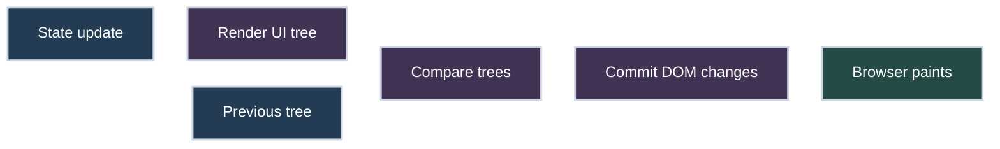
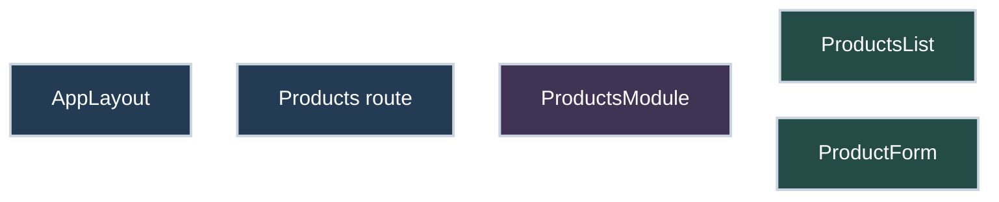
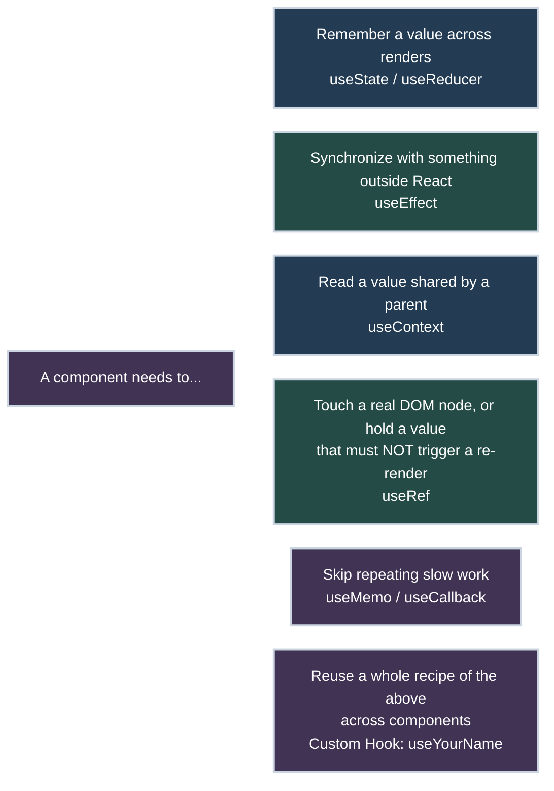
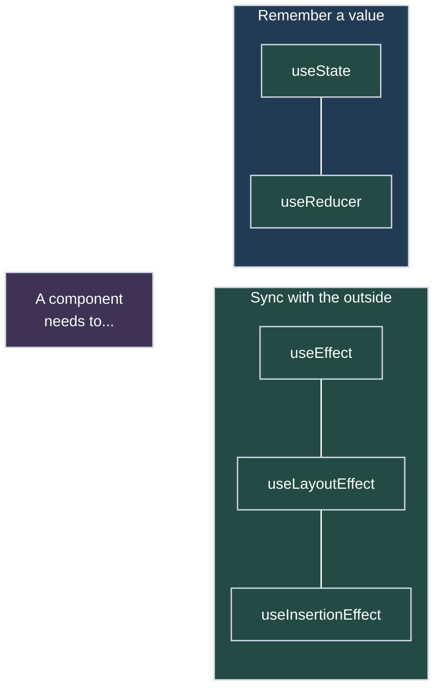
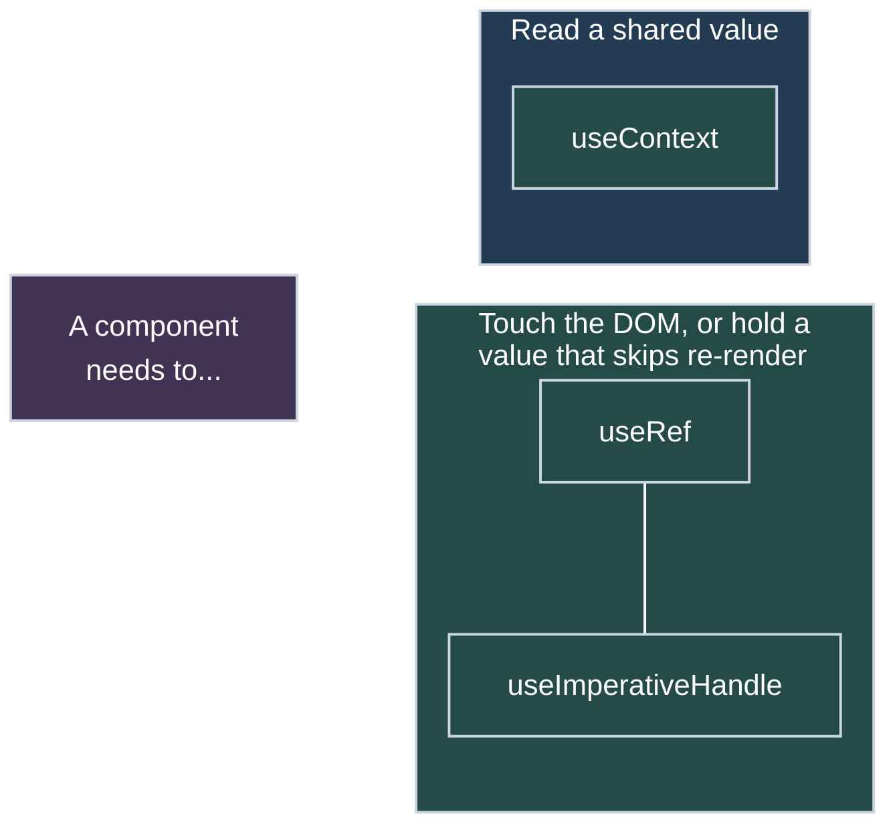
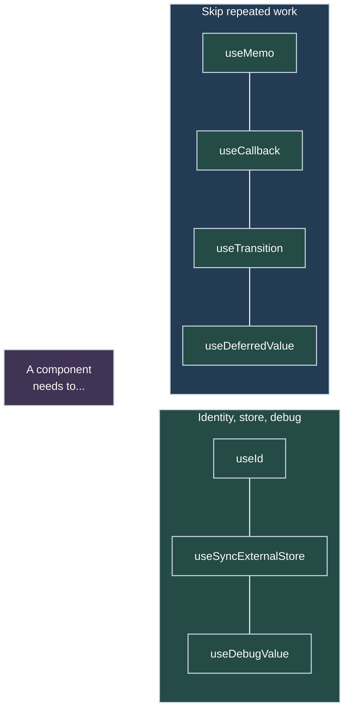
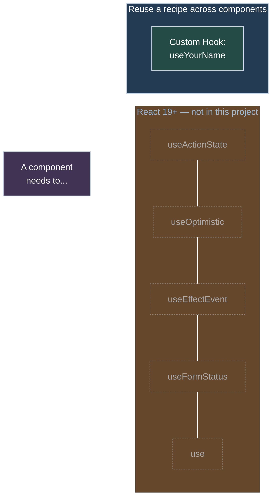
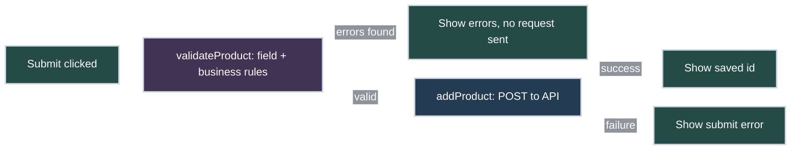
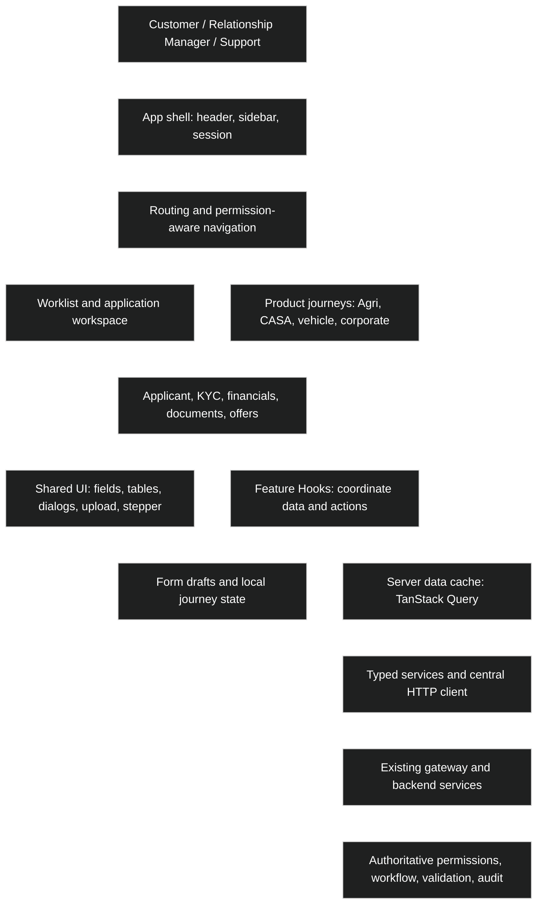
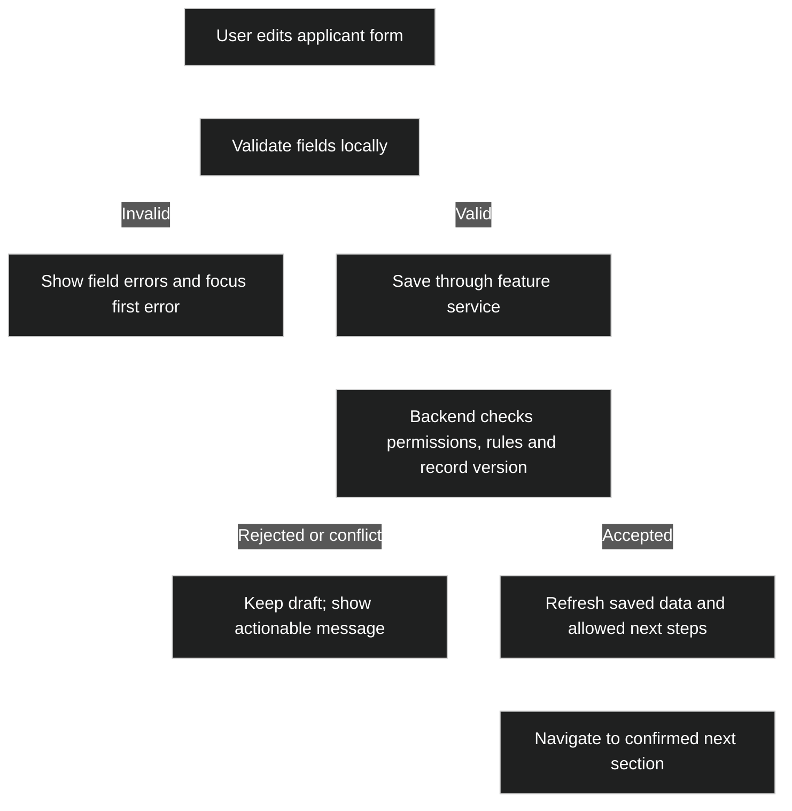

<a id="react--js-notes-plain-and-simple"></a>

# React + JS Notes (plain and simple)

This is the one place to study React and JavaScript for this project. Read the topics in the Study Path order, use the real project examples, then review the matching question in the Interview Question Bank.

Each topic follows the same short shape:

1. **What it is** — plain words first.
2. **Where to look** — a real file in this project.
3. **Term** — the interview name and a short definition.
4. **Angular** — the closest comparison.
5. **Takeaway or practice result** — an interview answer only for an actual interview question.

Diagrams appear directly in the relevant chapter. They are supporting material, not a separate place to study.

---

<a id="study-log"></a>

## Study Log

One line per topic studied, in order.

| # | Topic | Chapter |
|---|---|---|
| 1 | A component still re-renders even when nothing useful changed | [2.12 React.memo](#212-reactmemo) |
| 2 | The 3 ways to write useEffect, and what cleanup does | [2.4 useEffect](#24-useeffect) |
| 3 | Stale closures — why a function can keep using an old, frozen value | [2.13 Stale closures](#213-stale-closures) |
| 4 | What React Fiber is, and why typing can stay smooth while other work lags | [2.14 Fiber and useTransition](#214-fiber-and-usetransition) |
| 5 | Migrating a legacy app to React, and class components vs hooks | [0.6](#06-migrating-a-legacy-app-strangler-fig) / [2.15](#215-class-components--hooks) |
| 6 | What Redux is, and how we manage state without it | [2.16 Redux](#216-redux-and-doing-without-it) |
| 7 | The standard ways to call APIs in React, with a real axios example | [2.17 Calling APIs](#217-calling-apis-the-standard-ways) |
| 8 | What's synchronous vs asynchronous in React | [2.18 Sync vs async](#218-sync-vs-async-in-react) |
| 9 | Rendering content passed in as `children` (composition) | [2.19 children](#219-children-composition) |
| 10 | The 3 ways data flows between components | [2.20 Passing data](#220-passing-data-between-components) |
| 11 | Making a form survive navigating away and back | [2.21 Forms that survive navigation](#221-forms-that-survive-navigation) |
| 12 | Component → Service → HTTP layering, built as a paginated API list | [2.22 Paginated list](#222-paginated-list-component--service-layering) |
| 13 | JSX: what it is, why we use it, and how it differs from JavaScript | [2.1 JSX](#21-jsx) |
| 14 | Virtual DOM: comparing UI descriptions before changing the real page | [2.1.1 Virtual DOM](#211-virtual-dom) |
| 15 | How API data in React state becomes the browser UI through React DOM | [2.1.2 React DOM and API data](#212-react-dom-and-api-data) |
| 16 | Income module: lazy route, nested pages, TypeScript, Context, forms, and state-to-UI flow | [5.6 Income module](#56-income-module-route-api-data-state-and-forms) |
| 17 | Common React API patterns: native fetch, Axios, and a server-state query cache | [5.6 Income module](#56-income-module-route-api-data-state-and-forms) |
| 18 | Synchronous work, asynchronous Promises, and Observable streams in React | [5.6 Income module](#56-income-module-route-api-data-state-and-forms) |
| 19 | Products module: scaffold files and open nested routes | [5.7 Products user manual](#57-products-module--build-along-user-manual) |
| 20 | React Hooks: purpose, learning order, and calling rules | [Products Hooks overview](#575-hooks--understand-the-toolbox-first) |
| 21 | Practice state, Effect, Context, and ref in Products | [Four Hooks in TSX](#576-practice-four-hooks-in-the-products-tsx) |
| 22 | Product form: three Effect patterns and cleanup | [useEffect practice](#577-useeffect--three-simple-dependency-patterns) |
| 23 | How useRef remembers a value without requesting a render | [2.11 useRef](#211-useref) |
| 24 | Mutable means changeable: practice a ref with two buttons | [2.11 useRef](#211-useref) |
| 25 | JS, JSX, TS, TSX: extensions and enterprise convention | [1.11 File extensions](#111-js-jsx-ts-and-tsx) |
| 26 | useRef: open a hidden photo input with a button | [Choose a photo](#2111-useref--choose-a-photo) |
| 27 | What happens after a state change: a small counter | [2.3 useState](#23-usestate) |
| 28 | State ownership and read-only props | [State vs props](#2201-state-vs-props) |
| 29 | Proposed React architecture for the loan origination UI | [5.8 Architecture](#58-loan-origination-ui--proposed-react-architecture) |
| 30 | Managing a complex component: grouped state, an API call, validation, and business rules | [5.7.8 Complex component](#578-managing-a-complex-component-state-api-validation-business-rules) |
| 31 | All the built-in Hooks grouped by purpose, plus what makes a custom Hook and when to build one | [Hooks toolbox](#575-hooks--understand-the-toolbox-first) / [Custom Hooks](#custom-hooks--when-to-make-one) |
| 32 | A useEffect that watches the same state it sets, and fetches forever | [2.4 useEffect](#24-useeffect) / [Question bank](#interview-question-bank) |

---

<a id="study-path"></a>

## Study Path

Book-style index — Part, then sub-topic, then chapter, top to bottom. Each
`├─`/`└─` is a branch line off the Part directly above it; `│` continues
that line down to a nested sub-branch. *Planned* = not written yet.

1. **[Project foundation](#part-0)**
   - ├─ Understand this app: [building](#01-what-were-building), [app start](#02-how-a-react-app-is-wired-together), [file layout](#03-how-the-files-are-organized), [running it](#04-how-to-run-it)
   - └─ [React vs ReactJS](#05-reacts-versions-and-reactjs-vs-react)
2. **[JavaScript foundations](#part-1)**
   - ├─ Language building blocks: [vars/functions](#11-variables-and-functions), [destructuring/spread](#12-pulling-values-apart--copying-with-changes), [template strings](#13-text-with-variables-inside), [safe reads](#14-safe-reads--and-)
   - ├─ Working with data: [array methods](#15-array-tools-map-filter-reduce-find-foreach), [Set](#16-set--no-duplicates), [Dates](#17-dates), [JSON](#18-json--object-to-text-and-back)
   - └─ Files and async work: [import/export](#19-import--export), [Promises/dynamic import](#110-promises-and-import), [JS/JSX/TS/TSX](#111-js-jsx-ts-and-tsx)
3. **[React UI fundamentals](#part-2)**
   - ├─ Describe the screen: [JSX](#21-jsx), [Virtual DOM](#211-virtual-dom), [React DOM + API data](#212-react-dom-and-api-data), [function components](#22-a-component-is-a-function)
   - ├─ Build with components: [lists/keys](#28-lists-and-keys), [children/composition](#219-children-composition), [passing data](#220-passing-data-between-components)
   - └─ *Planned: conditional rendering, event handling*
4. **[State and hooks](#part-2)**
   - ├─ Core hooks: [useState](#23-usestate), [useEffect](#24-useeffect), [useRef](#211-useref) ([photo-picker practice](#2111-useref--choose-a-photo)), [Context](#26-context), [useReducer](#578-managing-a-complex-component-state-api-validation-business-rules)
   - ├─ Keep state correct: [derived state](#27-dont-save-what-you-can-calculate), [stale closures](#213-stale-closures), [forms survive navigation](#221-forms-that-survive-navigation)
   - ├─ Avoid unnecessary work: [useMemo](#25-usememo), [React.memo](#212-reactmemo), [Fiber/useTransition](#214-fiber-and-usetransition)
   - └─ *Planned: useCallback, custom hooks, hook rules*
5. **[Forms and routes](#part-3)**
   - ├─ Forms: [controlled forms](#29-forms)
   - └─ Routes: [BrowserRouter](#31-browserrouter), [nested routes](#32-nested-routes), [Link/NavLink/Navigate](#33-link-navlink-navigate), [useParams/useNavigate](#34-useparams-usenavigate), [lazy + Suspense](#210-lazy--suspense)
6. **[Data, shared state, storage](#part-4)**
   - ├─ Call an API: [standard API calls](#217-calling-apis-the-standard-ways), [sync vs async](#218-sync-vs-async-in-react), [service-layer pagination](#222-paginated-list-component--service-layering)
   - ├─ Share and save state: [Redux](#216-redux-and-doing-without-it), [localStorage](#41-localstorage)
   - └─ *Planned: React Query/SWR, React Hook Form*
7. **[Styling, testing, quality](#55-styling-tailwind)**
   - ├─ [Tailwind CSS](#55-styling-tailwind)
   - └─ *Planned: CSS Modules, accessibility, Jest, RTL, Playwright, Cypress*
8. **[Advanced React, real project work](#part-5)**
   - ├─ Understand existing code: [class components/hooks](#215-class-components--hooks), [migrating a legacy app](#06-migrating-a-legacy-app-strangler-fig)
   - ├─ [Loan origination React architecture](#58-loan-origination-ui--proposed-react-architecture)
   - ├─ Trace this project: [login/roles](#51-login-and-roles), [Income module](#56-income-module-route-api-data-state-and-forms), [Fixed Deposits](#52-fixed-deposit-part), [Mutual Funds](#53-mutual-fund-part), [Reports](#54-combined-report-page)
   - │&nbsp;&nbsp;└─ **[Products user manual](#57-products-module--build-along-user-manual)**: [open module](#571-open-the-module), [understand files](#572-understand-the-files), [route→screen](#573-follow-the-route-to-the-screen), [next topics](#574-continue-studying-this-module), [Hooks overview](#575-hooks--understand-the-toolbox-first), [4 Hooks practice](#576-practice-four-hooks-in-the-products-tsx), [useEffect patterns](#577-useeffect--three-simple-dependency-patterns), [complex form: state/API/validation](#578-managing-a-complex-component-state-api-validation-business-rules)
   - └─ *Planned: TypeScript, Zod, error boundaries, portals, animations, Next.js*
9. **[Interview revision — always last](#interview-question-bank)**
   - └─ [About this project](#61-tell-me-about-this-project), [React↔Angular terms](#62-react-word--angular-word), [Interview Question Bank](#interview-question-bank)

---

<a id="part-0"></a>

# Part 0 — 🗺️ The Big Picture

⬆ [Back to Study Path](#study-path)

<a id="01-what-were-building"></a>

## 0.1 What we're building

⬆ [Back to Study Path](#study-path)

A pretend investing app: **Fixed Deposits** (put money in for a fixed time, get interest back) and **Mutual Funds** (invest all at once, or a bit every month). Two roles: **Client** (can actually invest) and **Asset Manager** (can only view and explain, not buy/cancel/pay). No real backend — all data lives in the browser.

🔗 **Related topics:** [app start](#02-how-a-react-app-is-wired-together), [file layout](#03-how-the-files-are-organized), [running it](#04-how-to-run-it).

<a id="02-how-a-react-app-is-wired-together"></a>

## 0.2 How a React app is wired together

⬆ [Back to Study Path](#study-path)

**In Angular:** `AppModule` has a `declarations` list — every component must be registered there before it can be used, and a `bootstrap` array says which one starts the app. `main.ts` boots that module.

**In React: there's no such list, anywhere.** Instead:
- `index.js` is the real starting point. It finds one empty `<div id="root">`
  in the HTML page and tells React "put my `App` component in here."
- `App.js` is the one root component — like your root `AppComponent`.
- Every other component is simply **imported** wherever it's used —
  `import Navbar from './navBar'`, then `<Navbar />`. No registration list.
- The whole app is just a tree: `App` renders some components, those
  render more, and so on. Start at `App` and follow the imports down.
- Folders are only for humans to stay organized — React doesn't scan them.
  Only `import` lines actually connect anything.

📁 **Where to look:** [`index.js`](src/index.js) → [`App.js`](src/App.js) → [`AppLayout.js`](src/Components/AppLayout.js) is the actual chain in this project.

🅰️ **Angular side:** think of every `import Something from './Something'` as doing the job Angular's `declarations` array does — except it's per-file, not one central list, and it's required either way (Angular also needs the import statement *in addition to* the module registration).

🔗 **Related topics:** [building](#01-what-were-building), [file layout](#03-how-the-files-are-organized), [running it](#04-how-to-run-it).

<a id="03-how-the-files-are-organized"></a>

## 0.3 How the files are organized

⬆ [Back to Study Path](#study-path)

```
src/
  App.js            — shows login page, or the real app
  index.js          — the very first file that runs
  routes.js         — list of the app's big pages
  Components/
    AppLayout.js       — sidebar + top bar + current page
    Auth/              — login page + who's-logged-in logic
    AssetManagement/   — the investing part of the app
      FixedDeposit/
      MutualFund/
      Reports/
    Income/            — an older part, written in TypeScript
```

Each feature gets its own folder with everything it needs — its data, shared state, and pages, all together.

🔗 **Related topics:** [building](#01-what-were-building), [app start](#02-how-a-react-app-is-wired-together), [running it](#04-how-to-run-it).

<a id="04-how-to-run-it"></a>

## 0.4 How to run it

⬆ [Back to Study Path](#study-path)

```
npm install
npm start       # http://localhost:3000
```

You land on a login page. Any name, pick Client or Asset Manager — no real password.

🔗 **Related topics:** [building](#01-what-were-building), [app start](#02-how-a-react-app-is-wired-together), [file layout](#03-how-the-files-are-organized).

<a id="05-reacts-versions-and-reactjs-vs-react"></a>

## 0.5 React's versions, and "ReactJS" vs "React"

⬆ [Back to Study Path](#study-path)

**Clearing up a name mix-up first:** Angular had a real split — "AngularJS" (version 1) was thrown out and rewritten from scratch into "Angular" (version 2 onward) — different language, incompatible, basically two separate frameworks sharing a family name. **React never had this.** "React" and "ReactJS" are just two names for the exact same library — same as how people say "Node.js" instead of "Node." There's only ever been one React, just older and newer versions of it.

**The one big turning point — Hooks (React 16.8, 2019):** before this, only "class components" could hold state or run code on mount/update. Function components were just plain, simple display components. Then React added **Hooks** — `useState`, `useEffect`, and the rest — letting a plain function component do everything a class component could. The whole React world switched to function components + hooks after this. Everything in this project (and everything in Part 2 of this book) is written this modern way. Class components still run, but nobody writes new code with them anymore.

**Recent versions, short version:**
- **React 18 (2022)** — the new way to start an app, `createRoot` (what our
  own `index.js` uses), plus background-rendering performance work.
- **React 19 (Dec 2024)** — Server Components became official, a new
  `use()` hook, and a new **compiler** that can work out memoization
  automatically — which may make manually reaching for `useMemo`/
  `useCallback`/`React.memo` (see [2.12](#212-reactmemo)) much less
  necessary over time.
- **React 19.2 (Oct 2025)** — smaller additions, and React moved to its own
  independent **React Foundation** (hosted by the Linux Foundation).
- As of August 2026, the latest release is **19.2.8**. Our own project
  actually runs on **React 18** (see `package.json`) — still fully correct,
  current knowledge either way, just not the newest major version.

**One honest note about this project's setup:** we built this using **Create React App (CRA)**, which the React team has since stopped recommending. For a brand new project today, they now point people to **Vite** (for a plain app like this one) or **Next.js** / **React Router v7** (for a full framework with server rendering). CRA still works fine — nothing in this book stops being true — it's just no longer where you'd start a fresh project in 2026.

🅰️ **Angular side:** Angular does real major-version jumps too (15, 16, 17...), but stays one continuous framework the whole way through — closer to how React's own version history actually works. The "old version thrown away, new one built from scratch" story from Angular's past doesn't apply to React.

Sources: [React Versions – react.dev](https://react.dev/versions), [React 19.2 – react.dev](https://react.dev/blog/2025/10/01/react-19-2), [Create React App is Now Deprecated – Build5Nines](https://build5nines.com/create-react-app-is-now-deprecated-time-to-migrate-to-vite-or-next-js/)

<a id="06-migrating-a-legacy-app-strangler-fig"></a>

## 0.6 Migrating a legacy app (strangler fig)

⬆ [Back to Study Path](#study-path)

Rewriting a whole legacy app in one big-bang release is risky. The **strangler fig** approach instead migrates one piece at a time — new and old run side by side, more traffic shifts to the new pieces over time, until the old code can finally be deleted. Named after the strangler fig vine, which grows around a host tree until it fully replaces it.

📁 **Where to look:** [`routes.js`](src/routes.js) — each big feature (`Income`, `AssetManagement`) is its own independent, lazy-loaded route. That shape is exactly what a real strangler-fig migration needs: one route could point at a fully migrated React feature while another still points at old code, with neither affecting the other.

**Handling state during a migration** (general knowledge, not project- specific): common real approaches are a shared bridge like `localStorage`/cookies/URL params so session state (e.g. being logged in) survives a jump between old and new pages, keeping one backend as the single source of truth both frontends call, or mounting the new React piece as an "island" inside an old page and passing state in through props.

🗣️ **Say this in an interview:** "We used a strangler fig approach — migrating one module or route at a time, running legacy and new side by side, and gradually redirecting traffic until the legacy code could be safely deleted, instead of one risky big-bang rewrite."

---

🔗 **Related topics:** [class components/hooks](#215-class-components--hooks).

<a id="part-1"></a>

# Part 1 — 🧩 Plain JavaScript, used everywhere

⬆ [Back to Study Path](#study-path)

<a id="11-variables-and-functions"></a>

## 1.1 Variables and functions

⬆ [Back to Study Path](#study-path)

`const`/`let` store a value under a name. Arrow functions, `(x) => x + 1`, are a short way to write a function — used everywhere in React.

📁 **Where to look:** any file in `Components/` — every component is `const Name = () => {...}`.

🔤 **Term:** <span style="background-color: #263243; color: #dbeafe; padding: 0 0.18em; border-radius: 0.2em;">"arrow function"</span> = a short function-writing syntax (`(x) => x + 1`) that doesn't rebind the word `this`.

🅰️ **Angular:** you already use arrow functions the same way, e.g. inside `.subscribe(() => ...)`.

🔗 **Related topics:** [destructuring/spread](#12-pulling-values-apart--copying-with-changes), [template strings](#13-text-with-variables-inside), [safe reads](#14-safe-reads--and-).

<a id="12-pulling-values-apart--copying-with-changes"></a>

## 1.2 Pulling values apart / copying with changes

⬆ [Back to Study Path](#study-path)

`const { name } = person` pulls `name` straight out of an object. `{...person, age: 31}` makes a **new copy** with one thing changed — the original is untouched.

**Why:** React wants you to never change an object/array directly — always make a new one.

📁 **Where to look:** [`fdContext.js`](src/Components/AssetManagement/FixedDeposit/fdContext.js) — `[...prev, newFd]` adds one item without touching the old list.

🔤 **Term:** <span style="background-color: #263243; color: #dbeafe; padding: 0 0.18em; border-radius: 0.2em;">"destructuring"</span> and "spread." 🅰️ **Angular:** same rules — matters even more with `OnPush`, which checks "is this the same object?" the same way.

🔗 **Related topics:** [vars/functions](#11-variables-and-functions), [template strings](#13-text-with-variables-inside), [safe reads](#14-safe-reads--and-).

<a id="13-text-with-variables-inside"></a>

## 1.3 Text with variables inside

⬆ [Back to Study Path](#study-path)

`` `Hello ${name}!` `` (backticks) mixes text and variables, instead of `"Hello " + name + "!"`.

📁 **Where to look:** `fdContext.js` — `` `INV-FD-${Date.now()}` `` builds an ID.

🔤 **Term:** <span style="background-color: #263243; color: #dbeafe; padding: 0 0.18em; border-radius: 0.2em;">"template literal."</span> Same in Angular.

🔗 **Related topics:** [vars/functions](#11-variables-and-functions), [destructuring/spread](#12-pulling-values-apart--copying-with-changes), [safe reads](#14-safe-reads--and-).

<a id="14-safe-reads--and-"></a>

## 1.4 Safe reads: ?. and ??

⬆ [Back to Study Path](#study-path)

`a?.b` — if `a` doesn't exist, just get nothing back, don't crash. `a ?? b` — use `a`, unless it's completely empty, then use `b`.

📁 **Where to look:** [`authContext.js`](src/Components/Auth/authContext.js) — `user?.role` doesn't crash even when nobody's logged in yet.

🔤 **Term:** <span style="background-color: #263243; color: #dbeafe; padding: 0 0.18em; border-radius: 0.2em;">"optional chaining"</span> / "nullish coalescing." Same syntax in Angular templates too.

🔗 **Related topics:** [vars/functions](#11-variables-and-functions), [destructuring/spread](#12-pulling-values-apart--copying-with-changes), [template strings](#13-text-with-variables-inside).

<a id="15-array-tools-map-filter-reduce-find-foreach"></a>

## 1.5 Array tools: map, filter, reduce, find, forEach

⬆ [Back to Study Path](#study-path)

- `.map()` → new list, each item changed.
- `.filter()` → new list, only items that pass a test.
- `.reduce()` → one final answer (like a total).
- `.find()` → first matching item.
- `.forEach()` → just do something per item.

📁 **Where to look:** `fdCompare.js` (`.filter()`), `mfSubscriptions.js` (`.reduce()` for a total), `fdInvestForm.js` (`.find()` by ID).

🔤 **Term:** <span style="background-color: #263243; color: #dbeafe; padding: 0 0.18em; border-radius: 0.2em;">"array methods"</span> = built-in functions on every JS array for transforming or summarizing its items, without a manual loop.

🅰️ **Angular:** same methods, same way. (Not the same as RxJS's `.map()` on an Observable — that's a stream over time, this is a plain list.)

🔗 **Related topics:** [Set](#16-set--no-duplicates), [Dates](#17-dates), [JSON](#18-json--object-to-text-and-back).

<a id="16-set--no-duplicates"></a>

## 1.6 Set — no duplicates

⬆ [Back to Study Path](#study-path)

`new Set([...])` keeps only unique values.

📁 **Where to look:** `mfList.js` — builds the category filter with no repeats.

🔤 **Term:** <span style="background-color: #263243; color: #dbeafe; padding: 0 0.18em; border-radius: 0.2em;">"Set"</span> = a built-in JS collection that automatically drops duplicate values.

🔗 **Related topics:** [array methods](#15-array-tools-map-filter-reduce-find-foreach), [Dates](#17-dates), [JSON](#18-json--object-to-text-and-back).

<a id="17-dates"></a>

## 1.7 Dates

⬆ [Back to Study Path](#study-path)

`new Date(year, month, day)` — month is zero-based (January = `0`). `Date.now()` gives the current time as a number.

📁 **Where to look:** `mfSubscriptions.js` — works out the next SIP payment date.

🔤 **Term:** <span style="background-color: #263243; color: #dbeafe; padding: 0 0.18em; border-radius: 0.2em;">`Date`</span> = JavaScript's built-in object for representing a specific point in calendar time.

🅰️ **Angular:** same `Date`; Angular usually formats it with a `| date` pipe in the template instead.

🔗 **Related topics:** [array methods](#15-array-tools-map-filter-reduce-find-foreach), [Set](#16-set--no-duplicates), [JSON](#18-json--object-to-text-and-back).

<a id="18-json--object-to-text-and-back"></a>

## 1.8 JSON — object to text and back

⬆ [Back to Study Path](#study-path)

Browser storage only holds text. `JSON.stringify(obj)` → text. `JSON.parse(text)` → object again.

📁 **Where to look:** [`storage.js`](src/Components/AssetManagement/utils/storage.js) — does this once so no other file has to think about it.

🔤 **Term:** <span style="background-color: #263243; color: #dbeafe; padding: 0 0.18em; border-radius: 0.2em;">"JSON"</span> (JavaScript Object Notation) = a plain-text format for representing objects/arrays, used to send/store data.

🅰️ **Angular:** same `JSON`; usually wrapped in a service instead of a plain file.

🔗 **Related topics:** [array methods](#15-array-tools-map-filter-reduce-find-foreach), [Set](#16-set--no-duplicates), [Dates](#17-dates).

<a id="19-import--export"></a>

## 1.9 import / export

⬆ [Back to Study Path](#study-path)

`export default X` = this file's main thing. `export function y() {}` = a named extra, imported with `{ y }`.

📁 **Where to look:** `authContext.js` exports `useAuth`, `AuthProvider`, and `ROLES` all at once.

🔤 **Term:** <span style="background-color: #263243; color: #dbeafe; padding: 0 0.18em; border-radius: 0.2em;">"ES Modules"</span> = the `import`/`export` system that lets one file use code defined in another file.

🅰️ **Angular:** same `import`/`export`. Angular also has its own separate "module" idea (`NgModule` or a standalone component's `imports` list) — that's different from plain JS import/export.

🔗 **Related topics:** [Promises/dynamic import](#110-promises-and-import), [JS/JSX/TS/TSX](#111-js-jsx-ts-and-tsx).

<a id="110-promises-and-import"></a>

## 1.10 Promises and import()

⬆ [Back to Study Path](#study-path)

A Promise = a value that isn't ready yet, but will be. `import('./file')` (with parentheses) loads a file later, only when needed.

📁 **Where to look:** `routes.js` — the Asset Management part loads this way.

🔤 **Term:** <span style="background-color: #263243; color: #dbeafe; padding: 0 0.18em; border-radius: 0.2em;">"Promise"</span> = a JS object representing a value that will be available later, either successfully (resolved) or with an error (rejected).

🅰️ **Angular:** same trick powers Angular's own `loadChildren` lazy routes.

---

🔗 **Related topics:** [import/export](#19-import--export), [JS/JSX/TS/TSX](#111-js-jsx-ts-and-tsx).

<a id="111-js-jsx-ts-and-tsx"></a>

## 1.11 JS, JSX, TS and TSX

⬆ [Back to Study Path](#study-path)

The extension tells tools which syntax to expect. JavaScript and TypeScript can both describe React screens using JSX.

📁 **Where to look:** [`RefDemo.js`](src/Components/InterviewPrep/RefDemo.js) contains JSX in a JavaScript file; [`productsList.tsx`](src/Components/products/products-list/productsList.tsx) combines TypeScript and JSX; [`productsTypes.ts`](src/Components/products/productsTypes.ts) holds types without JSX. Open the ref example from **Learning · Hooks → useRef — Remember a value**.

🔤 **Term:** <span style="background-color: #263243; color: #dbeafe; padding: 0 0.18em; border-radius: 0.2em;">JSX</span> is HTML-like syntax inside JavaScript; TypeScript adds static type checking, and TSX means TypeScript with JSX.

| Extension | Typical use |
|---|---|
| `.js` | JavaScript logic; this project's build configuration also accepts JSX here |
| `.jsx` | JavaScript containing JSX, explicitly named for clarity |
| `.ts` | TypeScript logic, API functions, types, or Hooks without JSX |
| `.tsx` | TypeScript containing JSX, usually UI components |

```tsx
function Greeting({ name }: { name: string }) {
  return <h1>Hello {name}</h1>;
}
```

Remove `: { name: string }` for the JavaScript/JSX version. With type checking enabled, `<Greeting name={42} />` reports a mismatch before running. Types do not validate incoming API data at runtime.

🅰️ **Angular:** you already use TypeScript in `.ts` files; Angular templates use their own syntax. React uses `.tsx` when JSX appears alongside TypeScript.

**Project convention:** use `.tsx` for new components containing JSX and `.ts` for other new TypeScript code. Strict checking and CI type checks provide the type-safety benefit; the filename alone does not.

**This repo:** the recent JS demos followed the existing JavaScript style. It is currently mixed, and has no root `tsconfig.json` or type-check script. Its installed build configuration enables the TypeScript checker only when that config exists, so successful bundling alone does not prove type correctness. Renaming files alone would not complete TypeScript setup. For a JavaScript-only project, prefer JSX for UI and JS for logic; follow the team's configured tools consistently.

Sources: [React TypeScript guide](https://react.dev/learn/typescript), [TypeScript JSX](https://www.typescriptlang.org/docs/handbook/jsx.html), [strict](https://www.typescriptlang.org/tsconfig/strict.html), [noEmit](https://www.typescriptlang.org/tsconfig/noEmit.html).

---

🔗 **Related topics:** [import/export](#19-import--export), [Promises/dynamic import](#110-promises-and-import).

<a id="part-2"></a>

# Part 2 — ⚛️ React basics

⬆ [Back to Study Path](#study-path)

<a id="21-jsx"></a>

## 2.1 JSX

⬆ [Back to Study Path](#study-path)

JSX lets you describe what a screen should show using HTML-like tags inside JavaScript. It keeps the display and the values/events it uses close together, and makes nested UI easier to read than repeated function calls.

📁 **Where to look:** `src/Components/navBar.js` — `onClick={handleLogout}` passes a function, and `{user.username}` displays a JavaScript value.

🔤 **Term:** <span style="background-color: #263243; color: #dbeafe; padding: 0 0.18em; border-radius: 0.2em;">JSX</span> is a syntax extension for JavaScript that describes UI. Build tools transform it into JavaScript calls that create React elements; depending on the transform, these use JSX runtime helpers or `React.createElement`.

🅰️ **Angular:** compare JSX with an Angular component's template (inline or separate). Angular uses `{{ name }}` and `(click)`; JSX uses `{name}` and `onClick={handler}`, with JavaScript expressions for conditions and lists.

🗣️ **Say this in an interview:** JSX is a JavaScript syntax extension for describing UI with HTML-like markup. It improves readability, supports embedded JavaScript expressions, and must be transformed into JavaScript; React can also be used without JSX.

```jsx
const name = "Anuj";
const heading = <h1 className="title">Hello, {name}</h1>;
```

⚠️ **The trap:** <span style="background-color: #263243; color: #dbeafe; padding: 0 0.18em; border-radius: 0.2em;">JSX is neither an HTML string nor standard JavaScript syntax.</span> ✅ **The fix:** transform JSX before execution; use expressions inside `{}`, such as a ternary, rather than an `if` statement. See the final question bank.

🔗 **Related topics:** [Virtual DOM](#211-virtual-dom), [React DOM + API data](#212-react-dom-and-api-data), [function components](#22-a-component-is-a-function).

<a id="211-virtual-dom"></a>

## 2.1.1 Virtual DOM

⬆ [Back to Study Path](#study-path)

The browser keeps the actual page as a tree of objects called the DOM. Changing that tree can be expensive when many changes happen. React first creates a lightweight JavaScript description of the UI, often called the Virtual DOM. When state changes, React creates a new description, compares it with the previous one, and updates only the real DOM changes that are needed.

📁 **Where to look:** `src/Components/AssetManagement/assetOverview.js` — when `setNews(response.data)` runs, React renders a new description of the Market Updates list. It can add, remove, or change the list items without rebuilding the page's unrelated Fixed Deposits and Mutual Funds cards.



*Blue boxes hold data or route inputs; purple boxes perform work; green boxes show the UI. White arrows show direction.*

🔤 **Term:** <span style="background-color: #263243; color: #dbeafe; padding: 0 0.18em; border-radius: 0.2em;">Virtual DOM</span> is React's in-memory JavaScript tree that describes the UI. React compares the previous and next trees in a process called reconciliation, then commits the necessary changes to the browser's real DOM.

🅰️ **Angular:** Angular also works from an in-memory view of the template and updates bindings after change detection. React's common interview wording is "Virtual DOM + reconciliation"; Angular's is "change detection."

🗣️ **Say this in an interview:** The Virtual DOM is a JavaScript description of the UI, not a second browser DOM. After a state change, React compares the old and new descriptions and commits the necessary real-DOM changes. This reduces manual DOM work and can avoid unnecessary DOM mutations, though React still has to render and compare components.

⚠️ **The trap:** <span style="background-color: #263243; color: #dbeafe; padding: 0 0.18em; border-radius: 0.2em;">React does not automatically make every update fast.</span> ✅ **The fix:** keep renders sensible; use stable `key` values for lists and profile before adding `memo`, `useMemo`, or `useCallback`.

🔗 **Related topics:** [JSX](#21-jsx), [React DOM + API data](#212-react-dom-and-api-data), [function components](#22-a-component-is-a-function).

<a id="212-react-dom-and-api-data"></a>

## 2.1.2 React DOM and API data

⬆ [Back to Study Path](#study-path)

React DOM is the browser renderer for React. It receives React's UI description and makes the matching changes inside the real browser DOM. In this project, the `news` state starts as an empty array and the screen shows `Loading…`. When the API responds, `setNews(response.data)` requests another render. In that next render, `news.map(...)` describes one `<li>` for every returned item. React DOM compares that new description with the current page, removes the loading paragraph, and commits the list items to the browser DOM.

📁 **Where to look:** `src/index.js` creates the React DOM root with `ReactDOM.createRoot(...)`. `src/Components/AssetManagement/assetOverview.js` fetches three posts and binds each `item.title` to a list item. `src/Components/AssetManagement/utils/apiClient.js` creates the shared Axios client.


*Blue boxes hold data or route inputs; purple boxes perform work; green boxes show the UI. White arrows show direction.*

🔗 **Related topics:** [JSX](#21-jsx), [Virtual DOM](#211-virtual-dom), [function components](#22-a-component-is-a-function).

<a id="the-tiny-real-example"></a>

### The tiny real example

```jsx
// assetOverview.js
const [news, setNews] = useState([]);

const response = await apiClient.get("/posts", { params: { _limit: 3 } });
setNews(response.data);

// On the next render, each API object supplies a title to the UI.
{news.map((item) => (
  <li key={item.id}>{item.title}</li>
))}
```

Suppose the response is `[{ id: 1, title: "Markets open higher" }]`. Before it arrives, `news` is `[]`, so there is no `<li>` to describe. After `setNews(response.data)`, the next render sees that one object. `{item.title}` reads `"Markets open higher"` and JSX describes `<li>Markets open higher</li>`. React DOM then puts that text in the actual `<ul>` on the page. This is React's usual one-way data flow: API response → state variable → JSX expression → real DOM.

🔤 **Terms:** <span style="background-color: #263243; color: #dbeafe; padding: 0 0.18em; border-radius: 0.2em;">state</span> is data React remembers between renders. <span style="background-color: #263243; color: #dbeafe; padding: 0 0.18em; border-radius: 0.2em;">binding</span> here simply means an expression such as `{item.title}` reads a JavaScript value and places it in the UI. <span style="background-color: #263243; color: #dbeafe; padding: 0 0.18em; border-radius: 0.2em;">React DOM</span> is the React package that commits the result to the browser DOM.

🅰️ **Angular:** this is similar to an `HttpClient` response updating a component field, followed by Angular updating `*ngFor` and `{{ item.title }}` during change detection. In React, call the state setter; React runs the component again to get the next UI description, then React DOM commits the difference.

🗣️ **Say this in an interview:** After an API call resolves, I put the response in state. That triggers a new render, where JSX reads the state and describes the updated list. React DOM reconciles that result with the existing browser DOM and commits the required changes, such as replacing a loading message with list items.

⚠️ **The trap:** <span style="background-color: #263243; color: #dbeafe; padding: 0 0.18em; border-radius: 0.2em;">do not mutate `news` or directly write `document.querySelector(...).innerHTML`.</span> ✅ **The fix:** create the next value through `setNews(...)` and give each mapped item a stable `key`, such as `item.id`.

<a id="22-a-component-is-a-function"></a>

## 2.2 A component is a function

⬆ [Back to Study Path](#study-path)

A React component is a normal function that returns JSX. React calls it, gets the result, draws it on screen.

📁 **Where to look:** every file under `Components/`.

🔤 **Term:** <span style="background-color: #263243; color: #dbeafe; padding: 0 0.18em; border-radius: 0.2em;">"component"</span> = a reusable, self-contained piece of UI, written as a function (or class) that returns what should appear on screen.

🅰️ **Angular:** components are **classes**, not functions — one instance stays alive the whole time. React re-runs the whole function on updates; Angular re-checks the same live object instead.

🔗 **Related topics:** [JSX](#21-jsx), [Virtual DOM](#211-virtual-dom), [React DOM + API data](#212-react-dom-and-api-data).

<a id="23-usestate"></a>

## 2.3 useState

⬆ [Back to Study Path](#study-path)

React remembers a value between renders. Calling its setter requests an update; React runs the component again with the next value and updates the screen where needed.

📁 **Where to look:** [`StateCounterDemo.tsx`](src/Components/InterviewPrep/StateCounterDemo.tsx). Sidebar: **Learning · Hooks → useState — Update a number** (`/demo/state-counter`).

🔤 **Term:** <span style="background-color: #263243; color: #dbeafe; padding: 0 0.18em; border-radius: 0.2em;">"state"</span> = data that belongs to a component and can change over time; changing it is what makes React redraw the screen. `useState` is the hook that gives a component a piece of state.

**Terms:** a **setter** requests a state update; an **updater function** calculates the next value from pending state. A **render** is React calling the component to calculate its UI description. A **commit** applies necessary changes to the **DOM**, the browser's page elements. **Batching** means grouping updates to avoid unnecessary separate renders.

```tsx
const [count, setCount] = useState(0);
// In JSX:
<p>Count: {count}</p>
<button onClick={() => setCount(previous => previous + 1)}>Add one</button>
```

**Try it:** click **Add one**. The updater changes pending count from 0 to 1 → React renders the component with count 1 → React commits the changed text. The page does not reload. `useState(0)` does not reset the count on later renders; React retains state while this component remains mounted.

**The current handler keeps its old value:** immediately reading `count` after calling `setCount` still reads the current render's value. The next render receives the new value. React can batch updates; supplying the same value (compared with `Object.is`) normally lets it skip the update. Rendering a component does not mean replacing every DOM element.

🅰️ **Angular:** compare a click handler updating a field or signal followed by Angular updating template bindings. React uses a state setter and calls the component function again.

🗣️ **Say this in an interview:** “A state setter queues an update. React renders the component with the new state, compares the resulting UI with the previous result, and commits the necessary DOM changes. State is a snapshot within each render, and updates may be batched.”

🔗 **Related topics:** [useEffect](#24-useeffect), [useRef](#211-useref), [photo-picker practice](#2111-useref--choose-a-photo), [Context](#26-context).

<a id="24-useeffect"></a>

## 2.4 useEffect

⬆ [Back to Study Path](#study-path)

Runs something *after* the screen updates — like saving to `localStorage`, or starting a timer. There are 3 ways to write it:
- `useEffect(fn)` — no second argument — runs after **every** render. Rare,
  usually a mistake.
- `useEffect(fn, [])` — an empty list — runs **once**, right when the
  component first appears.
- `useEffect(fn, [x])` — runs again whenever `x` changes.

**Cleanup:** if `fn` returns another function, that returned function runs right before the component disappears (good for stopping timers, unsubscribing, anything that shouldn't keep running forever).

📁 **Where to look:**
- `fdContext.js` — `useEffect(() => saveToStorage(...), [myFds])`, the
  "runs when `x` changes" version — saves the FD list every time it changes.
- [`navBar.js`](src/Components/navBar.js) — a live session timer, the
  "runs once" version: `useEffect(() => { const id = setInterval(...); return
  () => clearInterval(id); }, [])`. It starts counting the moment you log
  in (that's when `Navbar` first appears), and the cleanup stops the timer
  the moment you log out (that's when `Navbar` disappears — see
  [`App.js`](src/App.js), which swaps to the login page entirely).
- [`UseEffectInfiniteLoopDemo.tsx`](src/Components/InterviewPrep/UseEffectInfiniteLoopDemo.tsx) (sidebar: Learning · Hooks → "useEffect — fix infinite API loop", route `/demo/effect-infinite-loop`) — one parent rendering two plain child components side by side, `BuggyUsers` and `FixedUsers`. Watch it *before clicking anything*: `FixedUsers` settles at "API called: 1" and stops; `BuggyUsers` keeps climbing on its own — no click needed, that's the actual bug (its own first fetch already changes `users`, which its dependency array is watching). Then click **Add user** in each — a real save, so it should cost exactly one API call: `FixedUsers` goes up by exactly 1 per click; `BuggyUsers`'s click adds fuel to the runaway chain that was already running.

🅰️ **Angular:** split across `ngOnInit` (≈ empty-array useEffect), `ngOnChanges` (≈ useEffect with deps), and `ngOnDestroy` (≈ the cleanup function) — or `effect()` in newer Angular, which behaves a lot like `useEffect` directly.

🔤 **Term:** <span style="background-color: #263243; color: #dbeafe; padding: 0 0.18em; border-radius: 0.2em;">"side effect"</span> = code that reaches outside the component itself (storage, timers, network) — `useEffect` is the hook for running it safely.

🗣️ **Say this in an interview:** "`useEffect` with no dependency array runs after every render. An empty array `[]` means it runs once, on mount. An array with values means it re-runs whenever one of those values changes. If the effect returns a function, that's the cleanup — it runs before the component unmounts, or right before the effect re-runs."

```js
useEffect(() => {
  const intervalId = setInterval(() => {
    setSessionSeconds((s) => s + 1);
  }, 1000);
  return () => clearInterval(intervalId); // cleanup
}, []); // empty array = run once, on mount
```

⚠️ **The trap:** putting the state a fetch *writes to* into that same Effect's <span style="background-color: #263243; color: #dbeafe; padding: 0 0.18em; border-radius: 0.2em;">dependency array</span> — the Effect re-runs whenever that state changes, but the Effect itself is what changes it, so it fires again immediately: fetch → `setUsers` → `users` changed → Effect re-runs → fetch again, forever.

```js
// Broken: fetches forever
useEffect(() => {
  fetch("/api/users").then(r => r.json()).then(data => setUsers(data));
}, [users]); // <-- reads the exact state this Effect just set
```

✅ **The fix:** if the Effect's job is to *populate* `users` from the server, it has nothing to "resynchronize" with when `users` changes — so it doesn't belong in the array. Fetch once, on mount:

```js
// Fixed: fetches once
useEffect(() => {
  fetch("/api/users").then(r => r.json()).then(data => setUsers(data));
}, []); // nothing reactive is read here that should restart this Effect
```

**A dependency array on its own is not the trap.** Most `useEffect(fn, [x])` calls are completely safe and don't loop — `useEffect(() => loadProduct(productId), [productId])` only reloads when `productId` changes *from somewhere else* (a route param, a prop). The loop only happens when an Effect both **reads** a value (dependency) and **writes** that exact same value (inside the Effect body) — read + write of the same thing is what re-triggers itself. Read-only dependencies never cause this.

**What "Add a user" actually does, step by step** (the two-version demo above): clicking it calls a plain function, not `useEffect` — nothing magically "calls" an Effect. That function does two separate things:
1. Makes its own real API call directly (e.g. a save/POST) — happens the same way in both versions, every time, unrelated to any Effect.
2. Calls `setUsers(...)` to update local state. Updating state doesn't call anything by itself — it makes React re-render, and *only after re-rendering* does React check every Effect's dependency list for changes.
   - **Buggy:** `users` is on the GET Effect's dependency list → React sees it changed → re-runs the GET Effect → a second, separate network call you never asked for.
   - **Fixed:** `users` isn't on that Effect's dependency list (`[]`) → React never rechecks it → the GET Effect simply never runs again, no matter how many times state changes.

🔗 **Related topics:** [useState](#23-usestate), [useRef](#211-useref), [photo-picker practice](#2111-useref--choose-a-photo), [Context](#26-context).

<a id="25-usememo"></a>

## 2.5 useMemo

⬆ [Back to Study Path](#study-path)

Skips redoing a slow calculation unless its inputs actually changed.

📁 **Where to look:** `fdInvestForm.js` — the payout amount only recalculates when amount/tenure change.

🔤 **Term:** <span style="background-color: #263243; color: #dbeafe; padding: 0 0.18em; border-radius: 0.2em;">"memoization"</span> = caching a calculation's result so it's only redone when its inputs change, not on every single render.

🅰️ **Angular:** `computed()` in newer Angular, or a "pure pipe" in classic Angular.

🔗 **Related topics:** [React.memo](#212-reactmemo), [Fiber/useTransition](#214-fiber-and-usetransition).

<a id="26-context"></a>

## 2.6 Context

⬆ [Back to Study Path](#study-path)

Lets a deeply nested component grab shared data directly, instead of passing it down through every component in between.

📁 **Where to look:** `fdContext.js`, `mfContext.js`, `authContext.js` — three separate shared boxes of data.

🅰️ **Angular:** solved differently — with Dependency Injection. A service (`@Injectable({providedIn:'root'})`) is just asked for in any constructor, no wrapping needed. Same problem, different fix.

🔤 **Term:** the problem Context avoids is called <span style="background-color: #263243; color: #dbeafe; padding: 0 0.18em; border-radius: 0.2em;">"prop drilling"</span>.

🔗 **Related topics:** [useState](#23-usestate), [useEffect](#24-useeffect), [useRef](#211-useref), [photo-picker practice](#2111-useref--choose-a-photo).

<a id="27-dont-save-what-you-can-calculate"></a>

## 2.7 Don't save what you can calculate

⬆ [Back to Study Path](#study-path)

If a value can be worked out from data you already have, don't store it separately — two copies can quietly fall out of sync.

📁 **Where to look:** `mfSubscriptions.js` — "next payment date" and "current value" are worked out fresh every time, never saved.

🅰️ **Angular:** use a plain **getter** instead of a separate field.

🔤 **Term:** <span style="background-color: #263243; color: #dbeafe; padding: 0 0.18em; border-radius: 0.2em;">"derived state."</span>

🔗 **Related topics:** [stale closures](#213-stale-closures), [forms survive navigation](#221-forms-that-survive-navigation).

<a id="28-lists-and-keys"></a>

## 2.8 Lists and keys

⬆ [Back to Study Path](#study-path)

Turning a list into JSX with `.map()` needs a `key` on each item — a name tag so React knows which item is which, even if the list reorders.

📁 **Where to look:** every list in the app uses a real ID as the key, never the item's position.

🔤 **Term:** <span style="background-color: #263243; color: #dbeafe; padding: 0 0.18em; border-radius: 0.2em;">"key prop"</span> = a stable identifier React uses to match list items across re-renders, so it can tell moved items apart from new ones.

🅰️ **Angular:** `*ngFor="let x of items; trackBy: fn"` — same job.

🔗 **Related topics:** [children/composition](#219-children-composition), [passing data](#220-passing-data-between-components).

<a id="29-forms"></a>

## 2.9 Forms

⬆ [Back to Study Path](#study-path)

React usually owns an input's value directly: give it `value` from state, update that state on every keystroke with `onChange`.

📁 **Where to look:** `fdInvestForm.js` — `value={amount}`, `onChange={(e) => setAmount(e.target.value)}`.

🅰️ **Angular:** `[(ngModel)]` for quick two-way binding, or Reactive Forms (`FormControl`) for the more React-like explicit version.

🔤 **Term:** <span style="background-color: #263243; color: #dbeafe; padding: 0 0.18em; border-radius: 0.2em;">"controlled input."</span>

<a id="210-lazy--suspense"></a>

## 2.10 lazy + Suspense

⬆ [Back to Study Path](#study-path)

Loads part of the app's code only when it's actually visited, instead of all at once. `Suspense` shows a loading message while it downloads.

📁 **Where to look:** `routes.js` — both big parts of the app load this way.

🅰️ **Angular:** built into the router directly (`loadChildren`), no separate wrapper needed (very new Angular's `@defer` is closer to `Suspense`).

🔤 **Term:** <span style="background-color: #263243; color: #dbeafe; padding: 0 0.18em; border-radius: 0.2em;">"code splitting."</span>

🔗 **Related topics:** [BrowserRouter](#31-browserrouter), [nested routes](#32-nested-routes), [Link/NavLink/Navigate](#33-link-navlink-navigate), [useParams/useNavigate](#34-useparams-usenavigate).

<a id="211-useref"></a>

## 2.11 useRef

⬆ [Back to Study Path](#study-path)

`useRef` remembers a value between renders. Changing that value does not ask React to run the component again.

📁 **Where to look:** [`RefDemo.js`](src/Components/InterviewPrep/RefDemo.js) — after login, choose **Learning · Hooks → useRef — Remember a value** in the sidebar (`/demo/use-ref`). This small component has just two buttons. The existing Products input-focus example is a separate DOM use case.

🔤 **Term:** <span style="background-color: #263243; color: #dbeafe; padding: 0 0.18em; border-radius: 0.2em;">"ref"</span> = a mutable container (`{ current: value }`) that persists across renders without triggering one when it changes.

React stores the ref with that mounted component's Hook data and returns the same object on later renders. The local variable is created again, but points to that retained object. The initial value initializes it only once per mount.

**Mutable means changeable:** `const box = { current: 0 }; box.current = 1;` changes a property inside the same object. `const` prevents reassigning `box` to another object; it does not freeze its properties. `useRef(0)` gives you this kind of box, with React remembering it between renders.

Assigning `ref.current = value` is an ordinary JavaScript property assignment. It does not call a state setter or schedule a React update. Persistence and scheduling renders are separate jobs; stable identity explains persistence, while the absence of an update request explains why no render starts.

```jsx
const clicks = useRef(0);
function rememberClick() {
  clicks.current += 1;
  alert(`Remembered clicks: ${clicks.current}`);
}
```

**Try it:** click **Remember a click** twice: alerts show 1, then 2, while the screen-update number stays 0. Click **Update the screen**: state changes and the component renders again. Click **Remember a click** once more: the alert shows 3, proving that the ref survived that render. The alert is a browser action called by the handler; showing it does not require a React render. The screen-update number counts that button's state updates, not all React renders.

⚠️ **The trap:** <span style="background-color: #263243; color: #dbeafe; padding: 0 0.18em; border-radius: 0.2em;">refs are not reactive screen data</span>. Use state for values shown in JSX. Read or write refs in handlers or Effects, not during rendering except predictable initialization. A fresh mount creates a fresh ref; it is not durable storage.

🅰️ **Angular:** a plain component instance field is the closest comparison for retained data; `@ViewChild` with `ElementRef` is the closest comparison for this DOM example. React function bodies run again during renders, while React retains their Hook data separately.

🗣️ **Say this in an interview:** “useRef returns a mutable object whose current property holds a value across renders. React returns the same object on subsequent renders, and changing current does not schedule an update, so I use refs for DOM nodes or timer IDs and state for screen data.”

Source: [React useRef reference](https://react.dev/reference/react/useRef).

🔗 **Related topics:** [useState](#23-usestate), [useEffect](#24-useeffect), [photo-picker practice](#2111-useref--choose-a-photo), [Context](#26-context).

<a id="2111-useref--choose-a-photo"></a>

### 2.11.1 useRef — Choose a photo

⬆ [Back to Study Path](#study-path)

We want a styled **Upload photo** button to open the browser's file picker. A hidden file input provides that browser feature; the button needs a way to access it.

📁 **Where to look:** [`UploadPhotoDemo.tsx`](src/Components/InterviewPrep/UploadPhotoDemo.tsx). Sidebar: **Learning · Hooks → useRef — Choose a photo** (`/demo/upload-photo`).

🔤 **Term:** <span style="background-color: #263243; color: #dbeafe; padding: 0 0.18em; border-radius: 0.2em;">DOM ref</span> stores access to an actual page element. Here, `fileInput.current` holds the hidden input after React attaches it.

**Terms used in this example:**

| Term or syntax | Meaning here |
|---|---|
| DOM (Document Object Model) | The browser's objects representing page elements, including this input |
| Reference | Access to an existing object, here the input element |
| `current` | The ref object's property holding the input |
| `HTMLInputElement` | TypeScript's DOM type describing an input element and its available methods |
| `<HTMLInputElement>` | A type argument: tells `useRef` what kind of element it will hold |
| `null` | An explicitly empty value, used before the input exists |
| `?.` (optional chaining) | Calls the method only when `current` is not null or undefined |
| `.click()` | A browser element method that activates the input |
| `type="file"` | Makes the input a file-selection control |
| `accept="image/*"` | Suggests image files in the picker; it is not file validation |
| `hidden` | Hides the input visually while keeping it available to the button |
| File picker | The browser/system dialog for choosing a local file |

```tsx
const fileInput = useRef<HTMLInputElement>(null);
// Inside the returned JSX:
<input type="file" accept="image/*" ref={fileInput} hidden />
<button onClick={() => fileInput.current?.click()}>Upload photo</button>
```

1. `useRef<HTMLInputElement>(null)` creates the ref, initially empty; the type says it will hold an input element.
2. `ref={fileInput}` tells React to place this input into `fileInput.current`.
3. Clicking the visible button calls the hidden input's `.click()`, which opens the picker. `?.` calls it only if the input exists.

**Try it:** click **Upload photo**, then choose an image or cancel. The input stays hidden. This focused demo does not display a preview or send a file to a server. Opening the picker needs no state update or React re-render; the browser handles it.

🅰️ **Angular:** similar to using `@ViewChild` with `ElementRef<HTMLInputElement>` and calling `nativeElement.click()`.

**Takeaway:** the button uses the ref to reach the hidden input. The input opens the browser's file picker.

🔗 **Related topics:** [useState](#23-usestate), [useEffect](#24-useeffect), [useRef](#211-useref), [Context](#26-context).

<a id="212-reactmemo"></a>

## 2.12 React.memo

⬆ [Back to Study Path](#study-path)

Tells one component: "only redraw if what I gave you is actually different from last time."

⚠️ **The trap:** <span style="background-color: #263243; color: #dbeafe; padding: 0 0.18em; border-radius: 0.2em;">a function written directly inside a parent is a brand new function every render</span>, even if it behaves the same. So `memo()` sees "looks new" and redraws anyway.

✅ **The fix:** <span style="background-color: #263243; color: #dbeafe; padding: 0 0.18em; border-radius: 0.2em;">wrap that function in `useCallback(fn, [])` in the parent</span>, so it stays the same function every time.

⚠️ **One more trap:** with `useCallback(fn, [])`, the function is built once — if it reads state directly, it'll use that state's very first value forever. Fix: <span style="background-color: #263243; color: #dbeafe; padding: 0 0.18em; border-radius: 0.2em;">`setValue((prev) => !prev)` instead of `setValue(!value)`</span>.

📁 **Where to look:** [`AppLayout.js`](src/Components/AppLayout.js) — `toggleSideNav` uses `useCallback` + the `(prev) =>` fix. [`navBar.js`](src/Components/navBar.js) — wrapped in `memo()`, shows a render counter next to the title so you can watch it stay flat.

🅰️ **Angular:** `changeDetection: ChangeDetectionStrategy.OnPush` — same idea, same trap (a function written inline in a template also breaks it there).

🔤 **Term:** <span style="background-color: #263243; color: #dbeafe; padding: 0 0.18em; border-radius: 0.2em;">"referential equality"</span> = comparing whether two things are the exact same object/function in memory, not whether they look the same.

🗣️ **Say this in an interview:** "`React.memo` skips re-rendering a component if its props are shallowly equal to last render's — same reference, not just same-looking value. That's called referential equality. The common gotcha: passing an inline function or object as a prop creates a new reference every render, so `memo` never sees equal props and the optimization does nothing — the fix is `useCallback`/`useMemo` in the parent to keep that reference stable."

```js
// AppLayout.js (parent) — keeps the same function reference every render
const toggleSideNav = useCallback(() => {
  setSideNavOpen((prev) => !prev);
}, []);

// navBar.js (child) — only re-renders if its props actually changed
const Navbar = memo(function Navbar({ toggleSideNav }) {
  /* ... */
});
```

🔗 **Related topics:** [useMemo](#25-usememo), [Fiber/useTransition](#214-fiber-and-usetransition).

<a id="213-stale-closures"></a>

## 2.13 Stale closures

⬆ [Back to Study Path](#study-path)

A function "remembers" the variables around it from the moment it was created. A **stale closure** is when that remembered value goes old/wrong, because the real value has since changed, but the function keeps using the value it first remembered.

**Where this bites you most:** `useEffect(fn, [])` runs `fn` only once — so anything created *inside* `fn`, like a `setInterval` callback, is also only ever built once. It's frozen with whatever the surrounding variables equalled at that one moment, forever.

📁 **Where to look:** [`navBar.js`](src/Components/navBar.js) — the session timer. If its interval read `sessionSeconds` directly instead of using the updater form, it would freeze at the value from the render when the effect first ran (`0`), and the timer would get stuck at `1` forever instead of counting up — every tick would compute `0 + 1` again and again. The actual code avoids this with `setSessionSeconds((s) => s + 1)`: instead of reading the frozen variable, it asks React for whatever the real value is *right now*.

⚠️ **Same trap, different spot:** [2.12](#212-reactmemo)'s `toggleSideNav` in `AppLayout.js` has the identical issue with `useCallback(fn, [])` — fixed the same way, with `setSideNavOpen((prev) => !prev)`.

✅ **The other fix — useRef:** the updater-function trick above only works when you're updating a value based on its *own* previous value. If a mount-once effect needs to read some *other* value that keeps changing, <span style="background-color: #263243; color: #dbeafe; padding: 0 0.18em; border-radius: 0.2em;">keep a `useRef` updated on every render, and read `ref.current` inside the effect</span> — a ref is one stable object, so reading it always gets the current value, even from inside an old closure.

🅰️ **Angular:** this exact trap doesn't really exist in Angular the same way. Angular components are persistent objects — reading `this.someValue` inside a `setInterval` always reads the live value off that same object, since there's no "component function re-run from scratch" the way React has.

🔤 **Term:** <span style="background-color: #263243; color: #dbeafe; padding: 0 0.18em; border-radius: 0.2em;">"stale closure"</span> = a function that keeps using an old, frozen value from when it was created, instead of the current value.

🗣️ **Say this in an interview:** "A stale closure happens when a function captures a variable's value at the time it was created, and that function never gets recreated — so it keeps using that old value even after the real state has changed. It shows up most with `useEffect`/`useCallback` using an empty dependency array. Fix it either with the functional updater form of a state setter, `setValue(prev => ...)`, or with a `useRef` that's always kept current."

```js
// Buggy — reads sessionSeconds directly, frozen at its value when the
// effect first ran (0). Every tick recomputes 0 + 1 and gets stuck at 1.
setInterval(() => setSessionSeconds(sessionSeconds + 1), 1000);

// Fixed — asks React for the real current value every time it runs.
setInterval(() => setSessionSeconds((s) => s + 1), 1000);
```

🔗 **Related topics:** [derived state](#27-dont-save-what-you-can-calculate), [forms survive navigation](#221-forms-that-survive-navigation).

<a id="214-fiber-and-usetransition"></a>

## 2.14 Fiber and useTransition

⬆ [Back to Study Path](#study-path)

**Fiber** is React's internal engine (since React 16) for figuring out what changed and updating the screen. Before Fiber, that work happened in one single pass that couldn't be paused — so a big update could make typing or clicking feel laggy, because React was busy finishing older work first. Fiber breaks the work into small pieces, so React *can* pause, handle something urgent (like a keystroke) first, then continue.

You never touch Fiber directly — but `useTransition` (React 18) lets you use the thing it enables: marking a state update as "not urgent, this can lag a little."

📁 **Where to look:** [`mfList.js`](src/Components/AssetManagement/MutualFund/mfList.js) — the search box. Two separate state values exist for one input on purpose: `searchInput` updates on every keystroke, instantly, no matter what. `searchQuery` — the one actually used to filter the list — is set *inside* `startTransition(...)`, so React can deprioritize it. The actual filtering has a deliberate 200ms artificial slowdown (our real mock data is only 5 schemes, filtering it is instant either way) — that's just there to simulate a genuinely large list, so you can actually feel the difference: type fast, and the letters stay instant while the list/"updating…" label visibly lag behind.

🔤 **Term:** <span style="background-color: #263243; color: #dbeafe; padding: 0 0.18em; border-radius: 0.2em;">"Fiber"</span> = React's internal engine (since React 16) that can pause, prioritize, and resume rendering work instead of doing it all in one uninterruptible pass.

🗣️ **Say this in an interview:** "Fiber is React's reconciliation engine, introduced in React 16. The old reconciler was synchronous and couldn't be interrupted; Fiber made rendering interruptible, so React can prioritize urgent updates like user input over less urgent ones like a big list re-render. That capability is what `useTransition` exposes to developers: Fiber enables concurrent rendering."

```js
const [isPending, startTransition] = useTransition();

function handleSearchChange(e) {
  const value = e.target.value;
  setSearchInput(value);           // urgent — updates every keystroke
  startTransition(() => {
    setSearchQuery(value);         // low-priority — React can deprioritize this
  });
}
```

🅰️ **Angular:** no direct equivalent. Angular's change detection runs synchronously through the tree when triggered — there's no built-in "mark this as low priority" the way `startTransition` gives you. Similar behavior in Angular usually means `runOutsideAngular` + manual scheduling, or just debouncing the input instead.

🔗 **Related topics:** [useMemo](#25-usememo), [React.memo](#212-reactmemo).

<a id="215-class-components--hooks"></a>

## 2.15 Class components → Hooks

⬆ [Back to Study Path](#study-path)

Before React 16.8 (2019), only **class components** could hold state or run code on mount/update — a function component was just a plain display component with no memory at all. Hooks let a plain function do everything a class could. Every real migration of old React code eventually means converting classes like this to hooks.

**The mapping:**
- `this.state` + `this.setState(...)` → `useState`
- `componentDidMount` + `componentWillUnmount` → one `useEffect(fn, [])`
  with a cleanup function (`return () => ...`)
- A plain instance field that shouldn't cause a re-render → `useRef`

📁 **Where to look:** [`SessionTimerClassExample.js`](src/Components/LegacyExamples/SessionTimerClassExample.js) — a reference-only file (never imported/rendered anywhere) showing the class-component version of the exact session timer that's actually live in [`navBar.js`](src/Components/navBar.js). Same behavior, two different eras.

```jsx
// Legacy — class component
componentDidMount() {
  this.intervalId = setInterval(() => {
    this.setState((prev) => ({ sessionSeconds: prev.sessionSeconds + 1 }));
  }, 1000);
}
componentWillUnmount() {
  clearInterval(this.intervalId);
}

// Modern — function + hooks (the real code in navBar.js)
useEffect(() => {
  const intervalId = setInterval(() => {
    setSessionSeconds((s) => s + 1);
  }, 1000);
  return () => clearInterval(intervalId);
}, []);
```

🔤 **Term:** <span style="background-color: #263243; color: #dbeafe; padding: 0 0.18em; border-radius: 0.2em;">"class component"</span> = the pre-2019 way to write a React component with state/lifecycle, as a JS class extending `React.Component`.

🗣️ **Say this in an interview:** "Migrating a class component to hooks means replacing `this.state` with `useState`, folding `componentDidMount` and `componentWillUnmount` into a single `useEffect` with a cleanup function, and turning instance fields that shouldn't trigger a re-render into `useRef`. The real challenge is usually that a class scatters related logic across separate lifecycle methods, while hooks let you group it by concern instead."

🅰️ **Angular:** Angular never had this particular split — components have always been classes, with no competing "function component" style the way React had before hooks. The closest Angular parallel to "an old pattern being phased out" is moving from `NgModule`-based components to modern **standalone components** — a real, ongoing migration in the Angular world too, just a different axis of change.

🔗 **Related topics:** [migrating a legacy app](#06-migrating-a-legacy-app-strangler-fig).

<a id="216-redux-and-doing-without-it"></a>

## 2.16 Redux, and doing without it

⬆ [Back to Study Path](#study-path)

Redux is a separate library (not part of React itself) for holding **all** of an app's shared state in one single place, called "the store." Instead of components changing state directly, they **dispatch an action** — a plain object describing what happened — and a **reducer** (a pure function) decides how the store should change in response.

Why people reach for it: once an app has many features all needing to read and update the same data, keeping it in one predictable, centrally-managed store (instead of many separate `useState`/Context values scattered around) makes it easier to track down "what changed, and why."

**We don't use Redux in this project — on purpose.** Redux is usually overkill unless the app is genuinely large, with lots of shared state and many components far apart in the tree that all need to read/update it. Here, each feature (Fixed Deposit, Mutual Fund, Auth) has its own small, separate Context instead — see [2.6](#26-context) — which is React's own built-in tool for the exact same "share state without passing it through every component" problem, just without Redux's extra rules (actions, reducers, a single combined store) or its extra package.

📁 **Where to look:** [`fdContext.js`](src/Components/AssetManagement/FixedDeposit/fdContext.js), [`mfContext.js`](src/Components/AssetManagement/MutualFund/mfContext.js), [`authContext.js`](src/Components/Auth/authContext.js) — three separate, independent "stores," one per feature, instead of one giant combined one.

```js
// Our approach: Context + useState, one small store per feature
const FdContext = createContext(undefined);
export function FdProvider({ children }) {
  const [myFds, setMyFds] = useState(() => loadFromStorage(STORAGE_KEY, []));
  function buyFd(purchase) {
    setMyFds((prev) => [...prev, { ...purchase, investmentId: `INV-FD-${Date.now()}` }]);
  }
  return <FdContext.Provider value={{ myFds, buyFd }}>{children}</FdContext.Provider>;
}

// The Redux equivalent, for comparison — one combined store, actions, a reducer:
// dispatch({ type: "fd/bought", payload: purchase })
// function fdReducer(state, action) {
//   switch (action.type) {
//     case "fd/bought": return { ...state, myFds: [...state.myFds, action.payload] };
//     default: return state;
//   }
// }
```

🔤 **Term:** <span style="background-color: #263243; color: #dbeafe; padding: 0 0.18em; border-radius: 0.2em;">"Redux"</span> = a library that holds all shared app state in one store, changed only via dispatched actions and pure reducer functions.

🗣️ **Say this in an interview:** "Redux centralizes all shared state into one store, updated only through dispatched actions and pure reducer functions — which makes state changes predictable and traceable, at the cost of extra boilerplate. For an app this size, with a handful of independent features, plain Context + useState per feature does the same job with far less ceremony. I'd reach for Redux (or a lighter alternative like Zustand) once state genuinely needs to be shared across many unrelated parts of a large app, or when I need tools like Redux DevTools' full action-by-action time-travel debugging."

🅰️ **Angular side:** Angular's closest equivalent is **NgRx** — same core idea (store, actions, reducers), built specifically for Angular. Angular also already has Dependency Injection (see [2.6](#26-context)'s Angular note) as a lighter built-in option for sharing state via a service, which is why NgRx, like Redux, is usually reached for only once an app's state genuinely outgrows that simpler approach.

🔗 **Related topics:** [localStorage](#41-localstorage).

<a id="217-calling-apis-the-standard-ways"></a>

## 2.17 Calling APIs the standard ways

⬆ [Back to Study Path](#study-path)

There are a few common, real ways React apps call backend APIs:

- **`fetch`** — built into every browser, no extra package needed, but a
  bit low-level (you have to manually check `response.ok`, call
  `.json()` yourself, etc.).
- **`axios`** — a popular library that does more out of the box: automatic
  JSON parsing, a cleaner error format, and **instances** you can
  pre-configure once (base URL, headers, timeout) instead of repeating that
  setup on every call. This is what we use.
- **TanStack Query (React Query) / SWR** — go a level further: instead of
  manually juggling loading/error/data state yourself with `useEffect` +
  `useState`, these libraries manage fetching, caching, retrying, and
  re-fetching for you. This is the modern industry-standard choice for
  any real production app doing a lot of data fetching — we don't use it
  here, to keep the concept itself (what's actually happening under the
  hood) visible rather than hidden behind a library.

📁 **Where to look:** [`apiClient.js`](src/Components/AssetManagement/utils/apiClient.js) sets up one shared axios instance — a base URL and an interceptor (a hook that runs on every request, normally used to attach an auth token or handle errors in one place). [`assetOverview.js`](src/Components/AssetManagement/assetOverview.js)'s "Market Updates" panel is the actual call, against a free public test API.

```js
// apiClient.js — configure once, reuse everywhere
const apiClient = axios.create({
  baseURL: "https://jsonplaceholder.typicode.com",
  timeout: 5000,
});

// assetOverview.js — the standard loading/error/success pattern
const [news, setNews] = useState([]);
const [newsLoading, setNewsLoading] = useState(true);
const [newsError, setNewsError] = useState(null);

useEffect(() => {
  let cancelled = false;
  async function fetchNews() {
    try {
      const response = await apiClient.get("/posts", { params: { _limit: 3 } });
      if (!cancelled) setNews(response.data);
    } catch (err) {
      if (!cancelled) setNewsError("Could not load market updates.");
    } finally {
      if (!cancelled) setNewsLoading(false);
    }
  }
  fetchNews();
  return () => { cancelled = true; }; // avoid setting state after unmount
}, []);
```

🔤 **Term:** <span style="background-color: #263243; color: #dbeafe; padding: 0 0.18em; border-radius: 0.2em;">"axios"</span> = a JS library for making HTTP requests, built on top of the browser's networking, with easier JSON handling than raw `fetch`.

🗣️ **Say this in an interview:** "We used axios for API calls — a shared instance configured once with the base URL and interceptors, so every call site doesn't repeat that setup. Every request follows the standard loading/error/success state pattern, with a cleanup flag in `useEffect` to avoid updating state after the component has unmounted. For a larger app I'd reach for React Query on top of axios, to get caching and automatic re-fetching without hand-rolling that state myself."

🅰️ **Angular side:** Angular has its own built-in `HttpClient` (no extra package needed, unlike React) — it returns RxJS Observables instead of Promises, and Angular's `HttpInterceptor` is the direct equivalent of axios's interceptor here. Angular doesn't ship a React-Query-style caching layer built in either — that's usually still a separate library choice.

🔗 **Related topics:** [sync vs async](#218-sync-vs-async-in-react), [service-layer pagination](#222-paginated-list-component--service-layering).

<a id="218-sync-vs-async-in-react"></a>

## 2.18 Sync vs async in React

⬆ [Back to Study Path](#study-path)

**Synchronous** = happens immediately, in order, one line finishing before the next starts. **Asynchronous** = started now, but finishes later — other code keeps running in between.

| Thing | Sync or async? |
|---|---|
| A component function running (JSX being built) | Sync |
| Calling a state setter (`setX(...)`) | Sync to call — but the actual re-render is scheduled, not immediate |
| An event handler's own code (`onClick={...}`) | Sync, unless it itself calls something async |
| `useEffect` setup | React schedules it after commit (usually after paint); when React runs it, its own JavaScript lines run synchronously |
| `useLayoutEffect`'s function body | Sync — runs before the browser paints (rare; blocks paint until done) |
| `fetch` / `axios` calls | Async — return a Promise, resolve later |
| `setTimeout` / `setInterval` | Async — their callback runs later |

**Where to look:** [`assetOverview.js`](src/Components/AssetManagement/assetOverview.js) has three `console.log`s placed specifically to show this order. Open the browser console and watch: `"1. Starting API call"` and `"2. This line runs BEFORE the API call finishes"` print immediately, in order — then `"3. API call finished"` prints later, once the network request actually completes. That gap is async code in action: the component's own render and the effect's setup run synchronously; the `axios.get(...)` call doesn't block anything else while it waits.

```js
console.log("1. Starting API call");
const response = await apiClient.get("/posts");  // this line "pauses" here...
console.log("3. API call finished");             // ...but other code keeps running elsewhere

// meanwhile, right after fetchNews() is called (not awaited at the call site):
console.log("2. This line runs BEFORE the API call finishes");
```

🔤 **Term:** <span style="background-color: #263243; color: #dbeafe; padding: 0 0.18em; border-radius: 0.2em;">"synchronous"</span> = happens immediately, in order. "Asynchronous" = started now, finishes later, while other code keeps running in between.

🗣️ **Say this in an interview:** "Rendering and starting a state update are synchronous JavaScript work, although React schedules the resulting render. Network calls and timers are asynchronous because they finish later. React schedules `useEffect` after committing the UI; the effect starts the request, and the Promise callback updates state later. `useLayoutEffect` runs before paint, so use it only when a DOM measurement must happen before the user sees the page."

🅰️ **Angular side:** Angular's change detection cycle for `this.value = x` in a component is also effectively synchronous once triggered — the same "sync render, async network call" split applies, just with `HttpClient` Observables instead of Promises on the async side.

🔗 **Related topics:** [standard API calls](#217-calling-apis-the-standard-ways), [service-layer pagination](#222-paginated-list-component--service-layering).

<a id="219-children-composition"></a>

## 2.19 children (composition)

⬆ [Back to Study Path](#study-path)

Sometimes a component should just be a wrapper — it doesn't know or care what's inside it. Whatever JSX you write **between** that component's opening and closing tags is automatically handed to it as `props.children`.

```jsx
function Card({ children }) {
  return <div className="border p-4">{children}</div>;
}

// The <h2> and <p> below become Card's children
<Card>
  <h2>Hello</h2>
  <p>Anything can go here</p>
</Card>
```

📁 **Where to look:** [`fdContext.js`](src/Components/AssetManagement/FixedDeposit/fdContext.js) — `FdProvider({ children })` does exactly this: `return <FdContext.Provider value={value}>{children}</FdContext.Provider>`. Every `<FdProvider>...</FdProvider>` you see in [`assetManagementModule.js`](src/Components/AssetManagement/assetManagementModule.js) is passing everything inside as `children`.

🔤 **Term:** <span style="background-color: #263243; color: #dbeafe; padding: 0 0.18em; border-radius: 0.2em;">"composition"</span> = building UI by nesting components inside each other, where a wrapper renders whatever JSX it's given as `children`.

🗣️ **Say this in an interview:** "This is called composition — a component receives arbitrary JSX as `children` and renders it wherever it wants, without needing to know what that content actually is. It's how Context Providers, layout wrappers, and modals are normally built in React."

🅰️ **Angular:** `<ng-content></ng-content>` is the direct equivalent — content projection. Whatever sits between a custom component's tags in the parent template gets projected into wherever `<ng-content>` is placed in that component's own template.

🔗 **Related topics:** [lists/keys](#28-lists-and-keys), [passing data](#220-passing-data-between-components).

<a id="220-passing-data-between-components"></a>

## 2.20 Passing data between components

⬆ [Back to Study Path](#study-path)

🔗 **Related topics:** [lists/keys](#28-lists-and-keys), [children/composition](#219-children-composition).

<a id="2201-state-vs-props"></a>

### 2.20.1 State vs props

⬆ [Back to Study Path](#study-path)

State is data a component owns and updates through a setter. Props are inputs it receives from its parent and must treat as read-only.

📁 **Where to look:** parent [`StatePropsDemo.tsx`](src/Components/InterviewPrep/StatePropsDemo.tsx) imports child [`CountDisplay.tsx`](src/Components/InterviewPrep/CountDisplay.tsx). The parent owns state and passes `count`; the separate child file receives and displays that prop. Sidebar: **Learning · Components → State and props — Parent / child**.

🔤 **Terms:** **parent** means the component rendering another component; **child** means the component it renders. **Props** (properties) are the values passed to that child. **State** is data React remembers for its owner. A **setter** requests a state update. A **callback** is a function passed to another component to call later. **Read-only** means the receiver must not change the input; TypeScript's `readonly` helps enforce property assignment rules during type checking.

```tsx
const [count, setCount] = useState(0); // In the parent: state.
<CountDisplay count={count} />        // For the child: a prop.
```

**Try it:** click **Add one in parent**. Both numbers change from 0 to 1. The parent updates its state; React then gives the child the new prop. One value can be state for its owner and a prop for its child.

**Can a child modify props?** It must not mutate them, including objects or arrays passed as props. Reassigning a local variable extracted from props does not update the parent's state. To request a change, the child can call a callback supplied by the parent; the parent performs the state update. The small demo keeps the button in the parent to make ownership clear.

🅰️ **Angular:** props resemble `@Input()`/input values. A callback prop for requesting an update resembles an `@Output()` event. React state belongs to its component, similar to a component field or signal used for its own UI.

🗣️ **Say this in an interview:** “State is owned by a component, while props are inputs received from its parent. Props are read-only to the receiving component; it requests changes through a callback rather than mutating them.”

<a id="2202-data-flow-patterns"></a>

### 2.20.2 Data-flow patterns

Three different situations, three different answers:

**Parent → child: props.**
```jsx
function Greeting({ name }) {
  return <p>Hello {name}</p>;
}
<Greeting name="Amit" />
```
📁 [`AppLayout.js`](src/Components/AppLayout.js) → `<SideNav isOpen={sideNavOpen} />`.

**Child → parent: a callback prop.** The parent passes a *function* down; the child calls it when something happens.
```jsx
function Child({ onSomething }) {
  return <button onClick={() => onSomething("clicked!")}>Click</button>;
}
```
📁 Same file — `<Navbar toggleSideNav={toggleSideNav} />`. `toggleSideNav` lives in the parent (`AppLayout`); `Navbar` just calls it.

**Two components with no parent/child relationship at all** (different pages, different routes): props can't help — lift the state up to their nearest shared ancestor, or use Context if that ancestor is too far away. 📁 `FdList`, `FdCompare`, and `MyFds` are three separate pages that never render at the same time, yet all read the same FD data — that's exactly what [`fdContext.js`](src/Components/AssetManagement/FixedDeposit/fdContext.js) is for.

🔤 **Term:** <span style="background-color: #263243; color: #dbeafe; padding: 0 0.18em; border-radius: 0.2em;">"lifting state up"</span> = moving a piece of state to the nearest shared ancestor of two components that both need it.

🗣️ **Say this in an interview:** "Parent to child is props. Child to parent is a callback function passed down as a prop, which the child calls. For components with no direct relationship, you lift shared state up to a common ancestor, or reach for Context once that ancestor is too many levels away to pass props through cleanly."

🅰️ **Angular:** props = `@Input()`. Callback props = `@Output()` + `EventEmitter`. Independent components = a shared injectable service (Angular's version of Context — see [2.6](#26-context)).

<a id="221-forms-that-survive-navigation"></a>

## 2.21 Forms that survive navigation

⬆ [Back to Study Path](#study-path)

**The problem:** a form's values normally live in its own `useState`. That state only exists while the component is mounted. Navigate away and the component is destroyed; come back and it's rebuilt from scratch — blank again, because `useState` reset.

**The fix:** lift the form's values up into something that doesn't unmount when the page does — a Context that wraps the whole feature, not just the one form page.

📁 **Where to look:** [`fdContext.js`](src/Components/AssetManagement/FixedDeposit/fdContext.js) holds `draftInvestments` (keyed by scheme id) and `updateDraftInvestment(schemeId, values)`. [`fdInvestForm.js`](src/Components/AssetManagement/FixedDeposit/fdInvestForm.js) reads its amount/tenure/payout/nominee from that draft instead of local `useState`, falling back to the scheme's defaults only the first time.

```js
// fdContext.js — lives here, not in the form component
const [draftInvestments, setDraftInvestments] = useState({});
function updateDraftInvestment(schemeId, values) {
  setDraftInvestments((prev) => ({ ...prev, [schemeId]: { ...prev[schemeId], ...values } }));
}

// fdInvestForm.js — reads from context
const draft = draftInvestments[scheme.id];
const amount = draft?.amount ?? scheme.minAmount;
```

**Why it works:** `FdProvider` wraps the entire `/assets/fd/*` area and stays mounted the whole time you're anywhere inside it. The individual form page mounts/unmounts as you navigate between it and the FD list — but the Context around it doesn't, so the draft survives even though the form component itself doesn't. (`buyFd` clears the draft for that scheme once the purchase actually completes.)

🔤 **Term:** <span style="background-color: #263243; color: #dbeafe; padding: 0 0.18em; border-radius: 0.2em;">"unmounting"</span> = a component being removed from the screen entirely — its local state is destroyed and won't come back on its own.

🗣️ **Say this in an interview:** "A component's own `useState` doesn't survive it unmounting. To keep form data alive across navigation, lift that state into something that outlives the individual page — a parent component, Context, or a store — instead of relying on the form's local state."

🅰️ **Angular:** components there get destroyed/recreated on route changes too — same problem, same fix: hold the draft in an injected service that outlives the component, or keep a Reactive Forms `FormGroup` at a level above the routed component.

🔗 **Related topics:** [derived state](#27-dont-save-what-you-can-calculate), [stale closures](#213-stale-closures).

<a id="222-paginated-list-component--service-layering"></a>

## 2.22 Paginated list (Component → Service layering)

⬆ [Back to Study Path](#study-path)

A real app splits "talk to the API" from "own the UI state and render the screen" into two separate files — a **service** layer and a **component** layer. Changing how data is fetched (REST → GraphQL, add caching, swap backends) then only touches the service file.

```
PaginatedPostsList.js  (component: page number, loading, error, data)
      ↓ calls
postService.js         (service: axios + the URL, nothing about React)
      ↓ sends
HTTP GET request
```

📁 **Where to look:** [`postService.js`](src/Components/InterviewPrep/PaginatedList/postService.js) (service) and [`paginatedPostsList.js`](src/Components/InterviewPrep/PaginatedList/paginatedPostsList.js) (component) — reachable at `/demo/paginated-list`.

```js
// postService.js
export async function fetchPostsPage(page, limit) {
  const response = await axios.get(`${BASE_URL}/posts`, { params: { _page: page, _limit: limit } });
  const totalCount = Number(response.headers["x-total-count"]) || 0;
  return { posts: response.data, totalCount, totalPages: Math.ceil(totalCount / limit) };
}

// paginatedPostsList.js
useEffect(() => {
  let cancelled = false;
  fetchPostsPage(page, PAGE_SIZE).then((result) => {
    if (!cancelled) { setPosts(result.posts); setTotalPages(result.totalPages); }
  });
  return () => { cancelled = true; };
}, [page]); // re-fetches whenever the page number changes
```

**Why `[page]` in the deps array is the whole trick:** clicking "Next" just does `setPage((p) => p + 1)`. That state change makes `page` different → `useEffect` re-runs → it calls the service again with the new page number. You never manually say "go fetch again" — changing the dependency is what triggers the refetch.

**Why the `cancelled` flag exists:** click "Next" twice fast, and the first request might finish *after* the second one. Without this flag, the slow first response could overwrite the newer second response on screen. The cleanup function runs right before the effect re-runs for the new page, marking the old request's result as one to ignore.

**Every concept this one feature touches:**

| Concept | Say this out loud |
|---|---|
| Service layer separation | "The component doesn't know axios exists — only `postService.js` talks to the network. Swap REST for GraphQL, only that file changes." |
| axios | "A library on top of the browser's fetch — cleaner JSON handling and errors, and lets you configure things like a base URL once." |
| async/await | "Sugar over Promises — `await` pauses this function at the network call without blocking the rest of the app." |
| useEffect + deps array | "Runs on mount and again whenever a value in the array changes — here `[page]`, so changing pages auto-triggers a refetch." |
| useEffect cleanup | "Runs before the effect re-runs, or on unmount — guards against a slow, stale request overwriting a newer one." |
| Loading/error/success state | "The standard three-state shape for any real network call — never show more than one at once." |
| Pagination math | "`totalPages = Math.ceil(totalCount / pageSize)`, with Previous/Next clamped so they can't go below page 1 or past the last page." |
| Sync vs async | "Rendering and calling `setPage` are synchronous; `axios.get` is asynchronous — it returns a Promise immediately, data arrives later, which is why loading state exists at all." |

🔤 **Term:** <span style="background-color: #263243; color: #dbeafe; padding: 0 0.18em; border-radius: 0.2em;">"service layer"</span> = the file(s) responsible only for talking to an API, kept separate from the component files that own UI state.

🗣️ **Say this in an interview:** "We separate the service layer (API calls) from the component layer (UI state and rendering) — the component never touches axios directly. Pagination re-fetches by putting the current page number in `useEffect`'s dependency array, so changing pages automatically triggers a new request; a cancelled flag in the cleanup avoids a slow, stale request overwriting a newer one if the user pages quickly."

🅰️ **Angular:** this split already has an official name and pattern in Angular — an injectable `@Injectable() PostService` (using `HttpClient`) is the direct equivalent of `postService.js`, injected into the component via the constructor rather than imported as a plain function.

**A note on naming:** you may have seen this pattern written as `EmployeeForm.jsx` + `EmployeeService.js` (PascalCase, `.jsx`) in tutorials — common, especially paired with a Spring Boot backend. This project uses lowerCamelCase + `.js` instead (`paginatedPostsList.js`). Both are just conventions — say either in an interview; what matters is the separation itself, not the casing.

**Bonus — if asked about a progress bar instead of a paginated list:** much simpler, no service layer needed at all — just a number ticking up in local state:
```jsx
const [progress, setProgress] = useState(0);
useEffect(() => {
  const id = setInterval(() => setProgress((p) => Math.min(100, p + 10)), 300);
  return () => clearInterval(id);
}, []);
// <div style={{ width: `${progress}%` }} /> inside a track div
```
Same `useEffect` + cleanup pattern as the session timer in `navBar.js` (see [2.4](#24-useeffect)). A **real** upload progress bar would instead come from axios's own `onUploadProgress` callback, not a fake timer — worth mentioning if pushed on it.

🔗 **Related topics:** [standard API calls](#217-calling-apis-the-standard-ways), [sync vs async](#218-sync-vs-async-in-react).

<a id="part-3"></a>

# Part 3 — 🧭 Moving between pages

⬆ [Back to Study Path](#study-path)

<a id="31-browserrouter"></a>

## 3.1 BrowserRouter

⬆ [Back to Study Path](#study-path)

Changes the page without a real browser reload — swaps the address bar and what's on screen.

📁 **Where to look:** `index.js` — wraps the whole app.

🔤 **Term:** <span style="background-color: #263243; color: #dbeafe; padding: 0 0.18em; border-radius: 0.2em;">"client-side routing"</span> = changing what's shown on screen based on the URL, entirely in the browser, without asking the server for a new page.

🅰️ **Angular:** `RouterModule` does the same job the same way.

🔗 **Related topics:** [nested routes](#32-nested-routes), [Link/NavLink/Navigate](#33-link-navlink-navigate), [useParams/useNavigate](#34-useparams-usenavigate), [lazy + Suspense](#210-lazy--suspense).

<a id="32-nested-routes"></a>

## 3.2 Nested routes

⬆ [Back to Study Path](#study-path)

A route can contain more routes inside it — its own smaller router for whatever comes after that part of the address.

📁 **Where to look:** `AppLayout.js` → `assetManagementModule.js` → `fdModule.js` — three levels deep. The full chain, file by file, for anything under `/assets/fd/...`:

```
index.js → App.js → AppLayout.js → routes.js
  → assetManagementModule.js  (matches "/assets/*", wraps FdProvider + MfProvider)
    → fdModule.js              (matches "fd/*" inside that)
      → fdList.js / fdCompare.js / fdInvestForm.js / myFds.js  (the actual pages)
```

Each arrow is one `<Route path="..." element={<NextFile />} />` line — open [`assetManagementModule.js`](src/Components/AssetManagement/assetManagementModule.js) and [`fdModule.js`](src/Components/AssetManagement/FixedDeposit/fdModule.js) side by side to see this exact handoff happening.

🔤 **Term:** <span style="background-color: #263243; color: #dbeafe; padding: 0 0.18em; border-radius: 0.2em;">"nested routing"</span> = a route whose own component renders further `<Routes>` internally, handling everything after its own path segment.

🅰️ **Angular:** a `children: [...]` list inside the route config, plus a `<router-outlet>` marking where it shows.

🔗 **Related topics:** [BrowserRouter](#31-browserrouter), [Link/NavLink/Navigate](#33-link-navlink-navigate), [useParams/useNavigate](#34-useparams-usenavigate), [lazy + Suspense](#210-lazy--suspense).

<a id="33-link-navlink-navigate"></a>

## 3.3 Link, NavLink, Navigate

⬆ [Back to Study Path](#study-path)

`<Link>` — clickable, changes the page. `<NavLink>` — same, but knows if it's the current page (for highlighting). `<Navigate>` — no click; the code itself jumps to a page.

📁 **Where to look:** `sideNav.js` (NavLink), `AppLayout.js` (`<Navigate to="/login" />` when nobody's logged in).

🔤 **Term:** <span style="background-color: #263243; color: #dbeafe; padding: 0 0.18em; border-radius: 0.2em;">`Navigate`</span> performs a "programmatic redirect" — a page change triggered by code/logic, not a user click.

🅰️ **Angular:** `routerLink`, `routerLinkActive`, `router.navigate([...])`.

🔗 **Related topics:** [BrowserRouter](#31-browserrouter), [nested routes](#32-nested-routes), [useParams/useNavigate](#34-useparams-usenavigate), [lazy + Suspense](#210-lazy--suspense).

<a id="34-useparams-usenavigate"></a>

## 3.4 useParams, useNavigate

⬆ [Back to Study Path](#study-path)

`useParams()` reads the changing part of the URL. `useNavigate()` jumps to a page from code, not a click.

📁 **Where to look:** `fdInvestForm.js` (useParams), `loginPage.js` (useNavigate, right after login).

🔤 **Term:** <span style="background-color: #263243; color: #dbeafe; padding: 0 0.18em; border-radius: 0.2em;">"route parameter"</span> = the dynamic part of a URL pattern (the `:id` in `path="scheme/:id"`), read out with `useParams()`.

🅰️ **Angular:** `ActivatedRoute`, and the `Router` service's `.navigate()`.

---

🔗 **Related topics:** [BrowserRouter](#31-browserrouter), [nested routes](#32-nested-routes), [Link/NavLink/Navigate](#33-link-navlink-navigate), [lazy + Suspense](#210-lazy--suspense).

<a id="part-4"></a>

# Part 4 — 🌐 Browser tools

⬆ [Back to Study Path](#study-path)

<a id="41-localstorage"></a>

## 4.1 localStorage

⬆ [Back to Study Path](#study-path)

Small storage built into the browser — survives a page refresh. We use it to fake "the backend remembers your data."

📁 **Where to look:** `storage.js` — one file every context uses.

🔤 **Term:** <span style="background-color: #263243; color: #dbeafe; padding: 0 0.18em; border-radius: 0.2em;">"localStorage"</span> = a Web Storage API built into every browser — a synchronous, string-only key-value store, scoped per website, that persists until explicitly cleared.

🅰️ **Angular:** same `localStorage`; usually wrapped in a service there too.

🔗 **Related topics:** [Redux](#216-redux-and-doing-without-it).

<a id="42-downloading-a-file-without-a-server"></a>

## 4.2 Downloading a file without a server

We build a CSV file entirely in the browser from data already on the page, and trick the browser into saving it.

📁 **Where to look:** `reportsModule.js` — the "Download CSV" button.

🔤 **Term:** <span style="background-color: #263243; color: #dbeafe; padding: 0 0.18em; border-radius: 0.2em;">"Blob"</span> (the file-like object) + `URL.createObjectURL` (the trick).

<a id="43-a-few-direct-dom-tools"></a>

## 4.3 A few direct DOM tools

`document.getElementById('root')` finds where React attaches, in [`index.js`](src/index.js). `document.createElement` + `.click()` is part of the download trick above, in `reportsModule.js`.

🔤 **Term:** <span style="background-color: #263243; color: #dbeafe; padding: 0 0.18em; border-radius: 0.2em;">"DOM"</span> (Document Object Model) = the browser's live, in-memory representation of the actual page — the thing React updates for you.

🅰️ **Angular:** same tools exist, though Angular usually steers you to `Renderer2`/`ElementRef` instead of touching the page directly.

---

<a id="part-5"></a>

# Part 5 — 🏗️ Our project

⬆ [Back to Study Path](#study-path)

<a id="51-login-and-roles"></a>

## 5.1 Login and roles

⬆ [Back to Study Path](#study-path)

No login = always land on the login page. Any name, pick Client or Asset Manager, no real password.

| Action | Client | Asset Manager |
|---|---|---|
| Browse, compare, view reports | Yes | Yes |
| Buy / start SIP | Yes | View only |
| Cancel / close early | Yes | No |
| Make a payment | Yes | No |

**How:** `authContext.js` works out one yes/no value, `canTransact`, fresh every time (see [2.7](#27-dont-save-what-you-can-calculate)). `AppLayout.js` sends you to the login page if nobody's logged in. Every button that can transact checks `canTransact` twice — once to decide whether to show the button, again on the actual page, in case someone types the address directly.

🅰️ **Angular:** route-level protection would be a `CanActivate` guard instead of a check inside the page. Button-level checks would be the same either way — a service value read with `*ngIf`.

🔗 **Related topics:** [Income module](#56-income-module-route-api-data-state-and-forms), [Fixed Deposits](#52-fixed-deposit-part), [Mutual Funds](#53-mutual-fund-part), [Reports](#54-combined-report-page).

<a id="52-fixed-deposit-part"></a>

## 5.2 Fixed Deposit part

⬆ [Back to Study Path](#study-path)

Folder: `AssetManagement/FixedDeposit/`

- `fdData.js` — pretend FD schemes + payout calculation.
- `fdContext.js` — remembers what you've bought, saved to `localStorage`.
- `fdList.js` — browse + compare + invest.
- `fdCompare.js` — side-by-side table.
- `fdInvestForm.js` — the buy form.
- `myFds.js` — what you own.

🔗 **Related topics:** [login/roles](#51-login-and-roles), [Income module](#56-income-module-route-api-data-state-and-forms), [Mutual Funds](#53-mutual-fund-part), [Reports](#54-combined-report-page).

<a id="53-mutual-fund-part"></a>

## 5.3 Mutual Fund part

⬆ [Back to Study Path](#study-path)

Folder: `AssetManagement/MutualFund/`

- `mfData.js` — pretend fund schemes + a rough value estimate.
- `mfContext.js` — remembers your subscriptions, saved to `localStorage`.
- `mfList.js` — browse + filter.
- `mfSchemeDetail.js` — pick a fund, start a SIP or invest a lump sum.
- `mfSubscriptions.js` — what you're invested in.

🔗 **Related topics:** [login/roles](#51-login-and-roles), [Income module](#56-income-module-route-api-data-state-and-forms), [Fixed Deposits](#52-fixed-deposit-part), [Reports](#54-combined-report-page).

<a id="54-combined-report-page"></a>

## 5.4 Combined report page

⬆ [Back to Study Path](#study-path)

File: `reportsModule.js` — pulls FD + Mutual Fund data together into one view, with a CSV download. Because it needs both at once, both contexts are set up higher up, in `assetManagementModule.js`, so this page can reach both (see [2.6](#26-context)).

🔗 **Related topics:** [login/roles](#51-login-and-roles), [Income module](#56-income-module-route-api-data-state-and-forms), [Fixed Deposits](#52-fixed-deposit-part), [Mutual Funds](#53-mutual-fund-part).

<a id="55-styling-tailwind"></a>

## 5.5 Styling (Tailwind)

⬆ [Back to Study Path](#study-path)

Ready-made small class names (`flex`, `p-4`, `bg-gray-800`) instead of writing your own CSS.

📁 **Where to look:** every `className`. (This project had Tailwind class names everywhere from the start, but Tailwind wasn't installed — so they did nothing until `tailwind.config.js`/`postcss.config.js` were added.)

🅰️ **Angular:** works identically — same class names, just in a template's `class="..."` instead of JSX's `className="..."`.

<a id="56-income-module-route-api-data-state-and-forms"></a>

## 5.6 Income module: route, API data, state, and forms

⬆ [Back to Study Path](#study-path)

The Income module now has two small, real API examples directly on `/income`. The page first renders its loading text. After the APIs reply, each response is saved in state. React runs `IncomeView` again, JSX reads the new values, and React DOM changes only the matching part of the browser page. The salary and freelance cards are still local mock records so the form exercise stays focused; the exchange-rate card and update list are real network data.

📁 **Where to look:** `src/routes.js` registers `/income/*`; `src/Components/AppLayout.js` lazy-loads it; `incomeModule.tsx` owns nested routes and the provider; `incomeApi.ts` owns URLs and response mapping; `incomeView.tsx` owns loading, error, and display state; `incomeContext.tsx` shares form data between the two form pages.


*Blue boxes hold data or route inputs; purple boxes perform work; green boxes show the UI. White arrows show direction.*

🔗 **Related topics:** [login/roles](#51-login-and-roles), [Fixed Deposits](#52-fixed-deposit-part), [Mutual Funds](#53-mutual-fund-part), [Reports](#54-combined-report-page).

<a id="read-the-real-code-in-this-order"></a>

### Read the real code in this order

1. Open `/income`. `routes.js` uses `lazy(() => import(...))`; `AppLayout` uses `Suspense` while that code downloads.
2. `IncomeView` renders immediately with `exchangeRate === null` and `updates === []`, so the JSX shows two loading messages.
3. Its two `useEffect` calls run after that first screen is committed. One calls `fetchUsdToInr`; the other calls `fetchIncomeUpdates`.
4. `incomeApi.ts` uses **native `fetch`** for `https://api.frankfurter.dev/v2/rate/usd/inr` and the shared **Axios** client for `https://jsonplaceholder.typicode.com/posts?_limit=3`.
5. `setExchangeRate(...)` and `setUpdates(...)` provide new state for the next render. `{exchangeRate.rate.toFixed(2)}` writes the number, while `updates.map(...)` creates one `<li>` per API object. React's Virtual DOM comparison sees that the loading text changed and React DOM commits the required text/list nodes.
6. `AbortController` is cleanup: leaving the page aborts an unfinished request so a response does not update an unmounted screen.

<a id="synchronous-asynchronous-promises-and-observables"></a>

### Synchronous, asynchronous, Promises, and Observables

**Synchronous** work finishes now, in order: `const total = 50000 + 15000`. **Asynchronous** work starts now and gives its result later: `fetch(...)` starts a network request but immediately returns a Promise. `async`/`await` and `.then(...)` are two ways to read that Promise later. `await` pauses only its own `async` function; it does not freeze the browser, React, or user clicks.

| | Promise (`fetch`, Axios) | Observable (RxJS / Angular `HttpClient`) |
|---|---|---|
| Values | One eventual success value or one error | Zero, one, or many values over time, then completion or error |
| Start and read | Call it; use `await` or `.then(...)` | Subscribe with `.subscribe(...)` |
| Cleanup | Abort the underlying request with `AbortController` when supported | Call `.unsubscribe()` in effect cleanup |
| Usual React choice | REST request → Promise → `setState` | Only when the project deliberately uses RxJS or consumes a stream such as live prices |

Angular `HttpClient.get()` returns an Observable, but a normal HTTP GET normally emits one response and completes. React has no built-in Observable API. In React, use a Promise for normal REST calls; for a real stream, subscribe inside `useEffect` and unsubscribe in its cleanup.

```tsx
// Synchronous: finishes before the next line.
const annualIncome = 50_000 * 12;

// Asynchronous Promise: starts now; the callback runs later.
fetchUsdToInr(signal).then(setExchangeRate);

// Observable pattern (only when a project uses RxJS):
useEffect(() => {
  const subscription = livePrice$.subscribe(setPrice);
  return () => subscription.unsubscribe();
}, []);
```

<a id="the-usual-react-api-patterns"></a>

### The usual React API patterns

React does not have one special “React API method.” These are the common layers, not competing rules:

| Pattern | In this Income module | Use it when |
|---|---|---|
| Native `fetch` + `useEffect` | `fetchUsdToInr` | A small feature needs a simple browser request. |
| Axios + `useEffect` + shared client | `fetchIncomeUpdates` | The app needs shared base URLs, timeouts, auth headers, or interceptors. |
| TanStack Query + a `queryFn` | Documented next step; not added here | Many screens reuse server data and need caching, retries, background refresh, or request deduplication. It can call either `fetch` or Axios. |

For a beginner module, start with the first or second pattern. For a larger application, put HTTP functions in a service file and add TanStack Query when server-state caching becomes a real requirement. React describes effects as synchronization with external systems such as a network; TanStack Query adds cache and server-state handling. [React guidance](https://react.dev/learn/you-might-not-need-an-effect) · [TanStack Query overview](https://tanstack.com/query/latest/docs/framework/react/overview) · [Frankfurter API](https://frankfurter.dev/) · [JSONPlaceholder guide](https://jsonplaceholder.typicode.com/guide/)

<a id="how-to-start-a-new-feature-module-tomorrow"></a>

### How to start a new feature module tomorrow

Create only the files the feature needs. Start with this shape, then grow it:

```text
src/Components/orders/
  ordersModule.tsx       route composition and providers
  ordersApi.ts           fetch/Axios functions plus response types
  ordersContext.tsx      only state shared by distant pages
  orders-list/           list screen and its styles
  orders-form/           create/edit screen and its styles
```

Add the outer `/orders/*` entry in `src/routes.js`, put inner `<Route>` entries in `ordersModule.tsx`, and keep a screen responsible for UI state. Put a value in Context only when separate pages need it; keep data used by one screen in that screen. Avoid putting every API response in Context—server data belongs in the screen or, later, a query cache.

<a id="jsx-versus-tsx"></a>

### JSX versus TSX

JSX is HTML-like UI syntax inside JavaScript. TSX is the same UI syntax inside TypeScript. The browser receives ordinary JavaScript in both cases; the build tool removes TypeScript types and transforms JSX/TSX before running it. Use `.jsx` or `.js` for JavaScript containing JSX; use `.tsx` when a TypeScript file contains JSX. This module uses TSX because it declares types such as `IncomeUpdate`, `IncomeFormData`, `ChangeEvent`, and `FormEvent`.

🔤 **Term:** <span style="background-color: #263243; color: #dbeafe; padding: 0 0.18em; border-radius: 0.2em;">TSX</span> is a TypeScript file that contains JSX. It adds compile-time checks such as “`amount` must be a number”; it does not create a different kind of React UI.

🅰️ **Angular:** this is closest to Angular TypeScript plus an HTML template in the same file. Context is similar to an injectable service for page-to-page form state. `useEffect` is a good place for this initial network synchronization, while a shared client or TanStack Query solves the cross-screen server-data concerns you would often handle with an Angular service plus RxJS.

🗣️ **Say this in an interview:** The Income route lazy-loads its module, then `IncomeView` calls two service functions after the first render. Each response goes into state, JSX maps that state to text or list items, and React DOM reconciles the loading UI with the returned data. TSX is JSX with TypeScript checks; it compiles to JavaScript before the browser runs it.

⚠️ **The trap:** <span style="background-color: #263243; color: #dbeafe; padding: 0 0.18em; border-radius: 0.2em;">Context is not the default home for all API data.</span> ✅ **The fix:** use local state for one screen, Context for client state shared by distant screens, and a query cache when server data must be shared, cached, and refreshed.

---

<a id="57-products-module--build-along-user-manual"></a>

## 5.7 Products module — build-along user manual

⬆ [Back to Study Path](#study-path)

This chapter is our step-by-step guide to building a small Products feature. Each thing we study will become a numbered subtopic here, with the relevant file, a simple explanation, and a way to check the result. We started with routed placeholders. Section 5.7.6 implements four core Hooks with a product request, quantity control, input focus, and shared currency. Section 5.7.8 implements the add-product form: grouped state, a real API call, field validation, and business rules.

🔗 **Related topics:** [open module](#571-open-the-module), [understand files](#572-understand-the-files), [route→screen](#573-follow-the-route-to-the-screen), [next topics](#574-continue-studying-this-module).

<a id="571-open-the-module"></a>

### 5.7.1 Open the module

⬆ [Back to Study Path](#study-path)

1. Start the app from the project folder with `npm start`. Use the local address printed in the terminal. If the existing installation cannot find `react-scripts`, run `node node_modules/react-scripts/bin/react-scripts.js start`.
2. Log in with the project's mock login.
3. Open `/products` on that local address. You should see **Products — Hooks practice** and a product after loading.
4. Open `/products/new`. You should see **New product** and the shared currency.

For example, when the app runs on port 3000, the list is at `http://localhost:3000/products`. There is currently no Products sidebar link, so enter the URL directly. These two placeholder routes were verified in the browser.

🔗 **Related topics:** [Products user manual](#57-products-module--build-along-user-manual), [understand files](#572-understand-the-files), [route→screen](#573-follow-the-route-to-the-screen), [next topics](#574-continue-studying-this-module).

<a id="572-understand-the-files"></a>

### 5.7.2 Understand the files

⬆ [Back to Study Path](#study-path)

📁 **Where to look:** all feature files are inside `src/Components/products/`. The outer route lives in `src/routes.js`.

| File | Responsibility | Current state |
|---|---|---|
| `src/routes.js` | Connect `/products/*` to the lazy-loaded feature | Connected |
| `productsModule.tsx` | Choose the Products screen from the remaining URL | Two routes |
| `products-list/productsList.tsx` | Display product data and Hook controls | Four-Hook practice |
| `product-form/productForm.tsx` | Add-product form: state, submit, errors | Implemented (5.7.8) |
| `product-form/productForm.validation.ts` | Field + business-rule checks | Implemented (5.7.8) |
| `productsApi.ts` | Fetch one dummy product; add a product | Implemented |
| `productsTypes.ts` | Describe Product fields | Implemented |
| `productsContext.tsx` | Supply a shared currency | Provider and custom Hook |

🔤 **Term:** <span style="background-color: #263243; color: #dbeafe; padding: 0 0.18em; border-radius: 0.2em;">feature module</span> here means a group of related components and files. `ProductsModule` is an ordinary React component; React does not require an Angular-style module registration system.

🔗 **Related topics:** [Products user manual](#57-products-module--build-along-user-manual), [open module](#571-open-the-module), [route→screen](#573-follow-the-route-to-the-screen), [next topics](#574-continue-studying-this-module).

<a id="573-follow-the-route-to-the-screen"></a>

### 5.7.3 Follow the route to the screen

⬆ [Back to Study Path](#study-path)

**`index`** means the default page at the parent URL: `/products` renders `ProductsList`. **`path="new"`** matches the extra URL segment `new`: `/products/new` renders `ProductForm`. The word `new` is a name we chose, not a React keyword; it does not create or save a product by itself. Both routes have a one-line explanation beside them in `productsModule.tsx`.

`AppLayout` checks whether you are logged in. Its route configuration matches `/products/*` and loads `productsModule.tsx`. `Suspense` provides a temporary fallback while that module's code loads. Inside the module, `index` selects the list for `/products`; `path="new"` selects the form for `/products/new`.



The blue boxes find the feature, purple chooses a nested route, and green identifies the screen. All boxes share the same border width and padding. The URLs share the same module; only the selected screen changes.

🅰️ **Angular:** compare the outer route with lazy feature routing and the inner routes with child routes. React's `<Routes>` chooses the matching `element`; the component function returns the screen markup.

🗣️ **Say this in an interview:** “I group a feature's screens and services in one folder, register its outer route, and let a feature component select the nested pages. I introduce API logic and shared state as the feature requires them.”

🔗 **Related topics:** [Products user manual](#57-products-module--build-along-user-manual), [open module](#571-open-the-module), [understand files](#572-understand-the-files), [next topics](#574-continue-studying-this-module).

<a id="574-continue-studying-this-module"></a>

### 5.7.4 Continue studying this module

⬆ [Back to Study Path](#study-path)

We will add each completed lesson as a subtopic in this chapter. The next planned topics are the Product type, list rendering, an API request with loading/error/data state, form inputs, and deciding whether Context is needed. They are planned work, not implemented behavior. Interview questions and their answers remain in the final question bank.

🔗 **Related topics:** [Products user manual](#57-products-module--build-along-user-manual), [open module](#571-open-the-module), [understand files](#572-understand-the-files), [route→screen](#573-follow-the-route-to-the-screen).

<a id="575-hooks--understand-the-toolbox-first"></a>

### 5.7.5 Hooks — understand the toolbox first

⬆ [Back to Study Path](#study-path)

In plain words: a normal JavaScript function forgets everything as soon as it finishes running. A component function re-runs on every render, so without help it would forget your input text, your loaded data, everything — on every single re-render. A **Hook is a small function that lets a component keep something between renders, or reach outside itself** (to the browser, to a shared value, to a real DOM element). React just gives each Hook call a private, permanent slot tied to that exact component, so the value survives even though the function itself re-runs from scratch every time.

We will learn their purpose first, then add them to Products one at a time. Section 5.7.6 demonstrates the first four Hooks in the TSX files.

📁 **Where to look:** `src/Components/products/products-list/productsList.tsx` is our future practice screen. Existing examples are `useState` and `useEffect` in `src/Components/income/income-view/incomeView.tsx`, and `useContext` inside `useIncome` in `src/Components/income/incomeContext.tsx`. `src/Components/products/productsContext.tsx` has a second, smaller custom Hook: `useProductCurrency`.

🔤 **Term:** <span style="background-color: #263243; color: #dbeafe; padding: 0 0.18em; border-radius: 0.2em;">Hook</span> is a function used by a component or another Hook to access React features. Its name starts with `use`, such as `useState`.

<a id="start-with-these-four"></a>

#### Start with these four

| Hook | Plain meaning | Products example we can build |
|---|---|---|
| `useState` | Remember a value; update the screen when it changes | Product quantity |
| `useEffect` | Synchronize with an external system | Request products when the screen opens |
| `useContext` | Read a provider's shared value | Read a currency chosen for several screens |
| `useRef` | Remember a mutable value without requesting a render | Hold the product-name input to focus it |

<a id="learn-these-when-a-feature-needs-them"></a>

#### Learn these when a feature needs them

| Hook | Plain meaning | Products example |
|---|---|---|
| `useReducer` | Organize state updates as named actions | Implemented in [5.7.8](#578-managing-a-complex-component-state-api-validation-business-rules): the add-product form |
| `useMemo` | Reuse a calculated result | An expensive product filter |
| `useCallback` | Reuse a function reference | A callback passed to an optimized row |
| `useId` | Generate an accessibility ID | Connect a label to its input |
| `useTransition` | Mark rendering work as less urgent | Keep typing responsive while results render |
| `useDeferredValue` | Let a displayed value lag behind urgent input | Defer a slow results panel |

<a id="specialized-hooks--recognize-their-names"></a>

#### Specialized Hooks — recognize their names

| Hook | Purpose |
|---|---|
| `useLayoutEffect` | Measure layout before paint |
| `useImperativeHandle` | Expose selected methods through a ref |
| `useSyncExternalStore` | Subscribe to an external store |
| `useDebugValue` | Label a custom Hook in DevTools |
| `useInsertionEffect` | Support CSS-in-JS style insertion |

These are the built-in Hooks to recognize in this project's React 18 dependency range. Learn the four basics first; add performance Hooks after identifying a performance problem. [React Hook reference](https://react.dev/reference/react/hooks)

<a id="newer-react-apis--awareness-only-in-this-project"></a>

#### Newer React APIs — awareness only in this project

The following APIs need newer React versions than this project's React 18 setup. We have not upgraded the app to use them.

| API | Simple purpose |
|---|---|
| `useActionState` | Track an action's result and pending state |
| `useOptimistic` | Show a temporary expected result while an action finishes |
| `useEffectEvent` | Read current values inside Effect logic without making those values dependencies of the Effect |
| `useFormStatus` from `react-dom` | Read the parent form submission status from a child component |
| `use` | Read a Promise or Context during rendering; this is a special React API with different calling rules |

References: [Action state](https://react.dev/reference/react/useActionState), [optimistic state](https://react.dev/reference/react/useOptimistic), [Effect Events](https://react.dev/reference/react/useEffectEvent), [form status](https://react.dev/reference/react-dom/hooks/useFormStatus), and [use](https://react.dev/reference/react/use).

<a id="a-small-decision-diagram"></a>

#### A small decision diagram

Six questions cover almost every built-in Hook. Read it as: "what does my component need right now?" → follow the matching branch.



<a id="every-hook-in-one-diagram"></a>

#### Every Hook, grouped

Every Hook from the tables above, grouped by the job it does. Landscape suits this content fine — the earlier version just crammed 8 groups into one wide diagram, so the whole thing got auto-shrunk to fit the page and the text turned to dust. The actual fix is fewer boxes per diagram (2 groups each, not 8), so each one stays small enough to render at full size. Read left to right: what you need → which Hook.

**1. Remember a value, or sync with the outside:**



**2. Read shared data, or touch the DOM:**



**3. Skip repeated work, or handle identity/store/debug:**



**4. Build your own, or use tomorrow's React:**



Solid boxes are usable in this project's React 18 today; dashed boxes (`useActionState`, `useOptimistic`, `useEffectEvent`, `useFormStatus`, `use`) need a newer React version than this project has — see [Newer React APIs](#newer-react-apis--awareness-only-in-this-project) above. They're here so you recognize the name, not because you can use them yet.

🔗 **Related topics:** [Start with these four](#start-with-these-four), [Learn these when a feature needs them](#learn-these-when-a-feature-needs-them), [Specialized Hooks](#specialized-hooks--recognize-their-names), [Custom Hooks — when to make one](#custom-hooks--when-to-make-one).

<a id="rules-to-keep-beside-your-code"></a>

#### Rules to keep beside your code

Call Hooks at the top level of a function component or custom Hook, before conditional returns. Do not call them inside loops, conditions, event handlers, or ordinary service functions. An event handler may call the setter returned by a Hook. React relies on a consistent Hook call order between renders. The special `use` API can be conditional, but still belongs in a component or Hook. [Rules of Hooks](https://react.dev/reference/rules/rules-of-hooks)

```tsx
// Illustrative component: we will add this behavior to Products in a later step.
function Quantity() {
  // Remember quantity between renders and provide its update function.
  const [quantity, setQuantity] = useState(1);
  // Clicking calls the setter; it does not call a Hook inside the event handler.
  return <button onClick={() => setQuantity(q => q + 1)}>{quantity}</button>;
}
// Import useState from React when using this example in a file.
```

<a id="custom-hooks--when-to-make-one"></a>

#### Custom Hooks — when to make one

A **custom Hook is just an ordinary function that calls other Hooks inside it**, with a name starting with `use` so React (and ESLint) knows to apply the Rules of Hooks to it. It is not a new kind of React feature — it is you giving a name to a recipe you keep repeating. It does not automatically share state between the components that call it; each call gets its own independent `useState`/`useEffect` unless the Hook itself reads a shared `Context`.

**When to make one — the actual trigger:** the moment you are about to copy-paste the same `useState` + `useEffect` (or any Hook combination) into a second component, stop and extract it into a custom Hook instead. A second good trigger: a component's top has grown to 4-5 unrelated Hook calls doing different jobs (loading data, tracking a form field, watching window size) — pulling each job out into its own named custom Hook makes the component read like a list of "what this screen needs," not "how each need is implemented."

**Already in this project — two real, small ones, so you don't have to imagine an example:**

| Custom Hook | Where | What it does | Built from |
|---|---|---|---|
| `useProductCurrency` | `src/Components/products/productsContext.tsx` | Reads the shared currency any Products screen needs | `useContext` |
| `useIncome` | `src/Components/Income/incomeContext.tsx` | Reads and updates the shared Income Context value | `useContext` |

Both are one-liners here because they wrap a single `useContext` call — that is already enough to count as a custom Hook: it gives the plain `useContext(SomeContext)` call a meaningful name, and hides the import of the raw Context object from every component that uses it.

**The most common custom Hooks you'll see in real apps** (names, not all built here — recognize the pattern):

| Name | Job |
|---|---|
| `useFetch` / `useApi` | Wraps a loading/error/data `useState` trio plus the `useEffect` that starts the request — see [2.22 Paginated list](#222-paginated-list-component--service-layering) for the shape this wraps |
| `useLocalStorage` | Behaves like `useState`, but also reads/writes the value to `localStorage` — see [4.1 localStorage](#41-localstorage) |
| `useToggle` | A boolean `useState` plus a function that flips it — replaces `const [on, setOn] = useState(false)` + `() => setOn(o => !o)` written out by hand each time |
| `useDebounce` | Delays updating a value until the user stops typing for N ms — built from `useState` + `useEffect` with a `setTimeout` cleanup |
| `usePrevious` | Remembers what a value was on the *last* render, using a `useRef` written to inside a `useEffect` |
| `useOnClickOutside` | Adds/removes a document click listener in a `useEffect`, using a `useRef` to know which element counts as "inside" |

**Where they live:** a Hook scoped to one feature (like our two above) lives right beside what it wraps — in the same Context/service file, not a separate folder. A Hook meant to be reused across *unrelated* features (like `useToggle` or `useDebounce`) belongs in one shared place, conventionally a `src/hooks/` folder with one file per Hook (`useToggle.ts`, `useDebounce.ts`), so anyone on the project checks that one folder first before writing a Hook that already exists.

**Names that are not built-in React Hooks:** `useNavigate` comes from React Router; `useQuery` comes from TanStack Query — both are custom Hooks themselves, built by those libraries the exact same way you'd build your own. `memo` is a React API, but it is not a Hook. `fetch`, `.map()`, and `async`/`await` are JavaScript/browser tools.

🅰️ **Angular:** `useState` roughly serves the role of screen fields/signals; `useContext` reads shared values somewhat like an injected service; `useRef` can hold an element reference. Effects synchronize external work, so they are not an exact replacement for every Angular lifecycle method. A custom Hook is the closest React equivalent to a small injectable Angular service that wraps a piece of reusable logic — except it's just a function, with no DI container or `@Injectable()` involved.

🗣️ **Say this in an interview:** “Hooks let function components use state, Context, refs, and Effects. I start with local state, introduce shared state when needed, and use Effects to synchronize with external systems. When I catch myself repeating the same Hook logic in a second component, I extract it into a custom Hook — a plain function starting with `use` that calls other Hooks inside it.”

🔗 **Related topics:** [5.7.6 Practice four Hooks](#576-practice-four-hooks-in-the-products-tsx), [5.7.8 Managing a complex component](#578-managing-a-complex-component-state-api-validation-business-rules), [2.6 Context](#26-context), [2.22 Paginated list](#222-paginated-list-component--service-layering).

<a id="576-practice-four-hooks-in-the-products-tsx"></a>

### 5.7.6 Practice four Hooks in the Products TSX

⬆ [Back to Study Path](#study-path)

Open `/products` after login. The page now fetches one dummy product, lets you increase its quantity, and lets you focus a note input. Open `/products/new` to see the same shared currency on another page. USD is a module setting chosen for this exercise, not a currency conversion.

📁 **Where to look:** `src/Components/products/products-list/productsList.tsx` contains the practice UI and one-line Hook comments. `productsApi.ts` calls [DummyJSON's single-product endpoint](https://dummyjson.com/docs/products); `productsContext.tsx` supplies currency; `productsModule.tsx` wraps both routes in that provider.

| Hook | When it is used | What to try |
|---|---|---|
| `useState` | React must remember quantity and API data between renders | Click **Add one**; quantity and total change |
| `useEffect` | The mounted page must request external data | Open the route; loading is replaced by a product |
| `useContext` via `useProductCurrency` | Both pages read the provider's currency | Both routes display USD without currency props |
| `useRef` | An event needs access to the actual input | Click **Focus note**; the cursor moves into the input |

🔤 **Term:** <span style="background-color: #263243; color: #dbeafe; padding: 0 0.18em; border-radius: 0.2em;">derived value</span> is calculated from current data: `product.price * quantity`. This small total needs neither another state variable nor `useMemo`.

The API Effect has `[]` dependencies, so quantity clicks do not restart it. Leaving the page cancels the unfinished request. On returning, the list mounts again, quantity starts at one, and data is requested again. The uncontrolled note input is not saved; its ref is only used to focus it.

🅰️ **Angular:** compare quantity to component state, the request to initial HTTP loading, currency to an injected shared value, and the input ref to an element reference.

🗣️ **Say this in an interview:** “I use state for rendered data, an Effect to load external data, Context for a shared currency, and a ref for input focus. Each Hook has a distinct purpose.”

🔗 **Related topics:** [Products user manual](#57-products-module--build-along-user-manual), [open module](#571-open-the-module), [understand files](#572-understand-the-files), [route→screen](#573-follow-the-route-to-the-screen).

<a id="577-useeffect--three-simple-dependency-patterns"></a>

### 5.7.7 useEffect — three simple dependency patterns

⬆ [Back to Study Path](#study-path)

Think of useEffect as: **after React updates the screen, do this external work when these values change.** The array answers “when should this run again?”

📁 **Where to look:** these three scenarios were first studied as commented-out examples in `productForm.tsx`. That file has since been implemented for real — see [5.7.8](#578-managing-a-complex-component-state-api-validation-business-rules) for the working form. The dependency-array reasoning below still applies to any Effect you write; this project's own form happens not to need one, since it loads no data on mount.

| Scenario | Write | Meaning |
|---|---|---|
| Load categories when opening a form | `useEffect(() => { loadCategories(); }, []);` | Run on mount. Typing should not request categories again. |
| Load the selected product | `useEffect(() => { loadProduct(productId); }, [productId]);` | Run initially; if ID changes from 1 to 2, load product 2. |
| Log every committed render | `useEffect(() => { console.log("Rendered"); });` | Run after every committed render, regardless of which value changed. |

**Start with the second scenario:** you open product 1, so React runs the Effect to load product 1. You change only its quantity: productId is still 1, so this Effect does not rerun. You select product 2: productId changed, so it runs again. That is what a dependency means.

🔤 **Term:** a **dependency** is a reactive value the Effect reads, such as productId. **Cleanup** is a function returned by the Effect to stop its previous work.

**Cleanup scenario:** the product-1 request is still running when you select product 2. Cleanup can cancel request 1, then the new setup starts request 2. It also runs when leaving the component. Calling an async function is not enough by itself to handle cancellation or errors; those details will be added with the actual request.

The empty array means once per mount, not once forever. Development Strict Mode can run an extra setup/cleanup cycle. Include the reactive values your Effect reads rather than choosing an array just to suppress reruns.

🅰️ **Angular:** think “initial load” for [], and “resynchronize when this input changes” for [productId]. These are useful comparisons, not exact lifecycle equivalents.

🗣️ **Say this in an interview:** “I use dependencies to keep external work synchronized with the values it needs. For product loading, the product ID is a dependency; cleanup stops obsolete work.”

🔗 **Related topics:** [2.4 useEffect](#24-useeffect), [5.7.8 Managing a complex component](#578-managing-a-complex-component-state-api-validation-business-rules), [2.17 Calling APIs](#217-calling-apis-the-standard-ways).

<a id="578-managing-a-complex-component-state-api-validation-business-rules"></a>

### 5.7.8 Managing a complex component (state, API, validation, business rules)

⬆ [Back to Study Path](#study-path)

Open `/products/new`. This form has four fields, one API call to save the product, and rules that go beyond "is it filled in" (a discount can't make the price zero or negative). Cramming all of that into one component with four separate `useState` calls and inline `if` checks gets hard to follow fast — a change to one field's logic risks breaking another. This project splits the concern into three pieces that each do one job:

- **Grouped state** — one `useReducer` holding all four fields as a single object, updated by one `{ type: "change", field, value }` action, instead of four independent `useState` setters that could drift out of sync.
- **Business rules in a pure function** — `validateProduct()` takes the form data in and returns an errors object out. It has no React in it, so it can be read (or unit-tested) on its own. Field checks (required, is-a-number) and cross-field business rules (discount can't exceed the price) live together, because both answer the same question — "is this data allowed" — just at different scope.
- **The API call in a service function** — `addProduct()` in `productsApi.ts` is the only place that knows the request shape; the component just calls it and handles loading/error/success state.

📁 **Where to look:** `src/Components/products/product-form/productForm.tsx` (the component: `useReducer` + submit handler), `product-form/productForm.validation.ts` (the rules), `productsApi.ts` (the `addProduct` request).



🔤 **Term:** <span style="background-color: #263243; color: #dbeafe; padding: 0 0.18em; border-radius: 0.2em;">business rule</span> is a check that depends on more than one field's meaning together, not just whether a single field looks well-formed — a discount of 100% making the price zero is a business rule, not a plain "is this required" check.

🅰️ **Angular:** compare `useReducer` here to a reactive form's single `FormGroup` value object, `validateProduct()` to a set of Angular Validators plus a custom cross-field validator, and the service function to an injected Angular service method — same separation of concerns, different syntax.

🗣️ **Say this in an interview:** “For a component with several related fields, an API call, and rules that span more than one field, I group the fields into one `useReducer` state instead of many `useState` calls, move validation and business rules into a pure function I can test on its own, and put the API call behind a service function. The component itself only wires those three together and renders loading/error/success — it doesn't contain the rules or the request shape.”

🔗 **Related topics:** [2.20 Passing data between components](#220-passing-data-between-components) (why grouped state avoids drift), [2.17 Calling APIs](#217-calling-apis-the-standard-ways), [2.9 Forms](#29-forms), [2.16 Redux, and doing without it](#216-redux-and-doing-without-it) (when state needs to be *shared*, not just grouped).

<a id="58-loan-origination-ui--proposed-react-architecture"></a>

## 5.8 Loan origination UI — proposed React architecture

⬆ [Back to Study Path](#study-path)

Architecture proposal only; no application code changed. Based on the supplied HDFC UI's `ARCHITECTURE.md`, `package.json`, route declarations in `src/app/app.module.ts`, and feature/core folder inspection. This is a structural review, not an endpoint or authentication audit. The repository describes loan origination; post-disbursement servicing such as repayment schedules and collections was not established by this review.

<a id="581-overall-structure"></a>

### 5.8.1 Overall structure

Recommend one modular React and TypeScript single-page application (SPA: a browser app that changes screens without loading a new HTML page each time). A module here means a business feature boundary, not an Angular NgModule. Keep existing backend contracts initially; confirm authentication and integration details before implementation.



Arrows describe access/dependency direction, not a mandatory sequence through every box. Saved data is owned by the backend. Feature pages compose shared UI and call their own feature Hooks. Shared UI must not import business features.

<a id="582-business-features-and-ownership"></a>

### 5.8.2 Business features and ownership

| Area | React responsibility |
|---|---|
| App shell | Header, role-aware sidebar, session expiry, notifications, route-level loading and failures |
| Worklist | RM case search, filtering, pagination, assignment and pending tasks |
| Application workspace | Application ID, progress, resume, section navigation and allowed actions |
| Applicant and KYC | Customer/entity, addresses, directors, guarantors, identity and consent screens; KYC means Know Your Customer |
| Financial assessment | Income, obligations, bank statements, GST and bureau-result display |
| Documents | Select, upload, review, retry, document status and signing handoff |
| Product journeys | Agri/Tractor, CASA account opening, UCV vehicle and corporate/SME variants using common sections where their contracts match |
| Review and offers | Review, submit, offer display and signing; backend confirms all business transitions |

Product configuration selects permitted steps and fields. Use a whitelist of known React components for any metadata-driven forms; do not execute server-supplied code. Keep product-specific business differences in their feature rather than filling every common component with conditions.

<a id="583-react-and-supporting-libraries"></a>

### 5.8.3 React and supporting libraries

| Feature | Definition and concrete use |
|---|---|
| Components and TSX | Small typed UI units: ApplicantPage contains AddressForm and DocumentPanel |
| Props and callbacks | Parent passes data down; child requests an action through a function prop |
| useState | Local screen state: selected tab, open dialog, selected file |
| useRef | Access a DOM element or retain a non-rendering value: hidden upload input, focus first invalid field |
| useReducer | Updates related state through named actions: local wizard navigation and draft status |
| Context / useContext | Share a scoped value: session summary, theme, or active journey; not every field in the whole app |
| Custom Hooks | Reusable React logic: application loading or document-upload coordination; code reuse does not automatically share state |
| useEffect | Synchronize with an external system, such as a subscription or idle timer, and clean it up |
| lazy and Suspense | Download a feature when required and show a loading fallback while it loads |
| Error boundary | Contain render failures to a page/section; handle request and event errors explicitly too |
| memo / useMemo / useCallback | Reuse component results, calculated values or function identities when profiling proves a benefit |
| React Router (external library) | Match URLs to pages, nested application sections and URL filters |
| TanStack Query (external library) | Cache server responses, track request status, update and refresh saved records |
| Form library (external) | Manage field values, validation errors, touched/dirty fields; evaluate React Hook Form against actual dynamic-form requirements |

React does not itself provide the router, HTTP client, form framework or server-data cache. Avoid selecting two tools to own the same state. Route loaders may prepare Query data; do not build a second conflicting cache beside Query. Ordinary Effect requests do not automatically activate Suspense.

Sources: [React state](https://react.dev/learn/managing-state), [Reducer and Context](https://react.dev/learn/scaling-up-with-reducer-and-context), [lazy](https://react.dev/reference/react/lazy), [React Router](https://reactrouter.com/start/data/routing), [TanStack Query](https://tanstack.com/query/latest/docs/framework/react/overview).

<a id="584-where-data-lives"></a>

### 5.8.4 Where data lives

| Data | Owner |
|---|---|
| Open modal or tab | Local useState |
| Current page, case ID and shareable filters | Router URL; no sensitive customer fields in URLs |
| Unsaved field values and validation | Form instance scoped to the application section |
| Local multi-step coordination | Journey-scoped reducer; persisted drafts on the backend |
| Saved application, worklist, lookup data | Query cache backed by APIs |
| Session summary and UI permissions | Session provider derived from the agreed identity contract |
| Final eligibility, permissions and approved stage | Backend, rechecked for every protected action |

A cache is a temporary copy, not a durable database. Query keys must distinguish application, user/business scope and filters; clear sensitive cached data on logout or scope changes. Refresh from the server after successful saves. Do not overwrite an unsaved form simply because a background refetch completed.

<a id="585-save-and-continue"></a>

### 5.8.5 Save and continue



Record version detects competing edits. Idempotency means retrying a protected action does not create a second application or duplicate submission; this needs backend support. Do not auto-retry a submission blindly or show an approval as successful before the server confirms it.

<a id="586-angular-mapping-and-deployment"></a>

### 5.8.6 Angular mapping and deployment

| Existing Angular idea | React replacement |
|---|---|
| Feature module | Feature folder with route, pages, Hooks, services and types |
| Component TS + HTML | TSX component |
| Input / Output | Props / callback props |
| Injectable service | Typed service functions; Context only where shared instances/values are needed |
| Reactive Forms | Form-library-managed values and validation |
| HttpClient interceptors | Central HTTP pipeline for agreed auth/business headers, errors and cancellation |
| Route guards | Client route checks for UX plus mandatory backend authorization |
| ViewChild | DOM ref |
| RxJS subscription | Preserve streams where needed; Promises/Query for ordinary request-response data |

Proposed organization: app (routing/providers/shell), features (business areas), shared/ui (fields/buttons/tables), platform (HTTP/session/telemetry), and tests. Components use `.tsx`; services, types and pure logic use `.ts`. A design system means consistent shared controls and visual rules.

Package the React assets using the existing container/static-hosting delivery model after verifying its actual environment requirements. CI (automated checks before release) should run strict type checks, lint, unit/component tests, API-contract tests and complete journey tests. Test session expiry, role restrictions, upload failure, resume and concurrent edits. Telemetry means error/performance observations; redact customer data. Business audit records belong on the server.

Prefer one deployment with clear feature boundaries initially. Micro-frontends (separately deployed UI applications) add integration and session complexity and should require a demonstrated team/release need. An authenticated existing-backend app does not automatically require server-rendered React or Server Components. Any optional BFF (backend dedicated to this frontend) needs a concrete session/aggregation requirement and backend agreement.

Migration: inventory routes/contracts → shared shell/session → one low-risk worklist → one complete applicant-to-save journey → remaining product journeys. During coexistence, assign each URL to Angular or React and confirm session and callback continuity. Keep rollback possible at a route boundary. Server workflows remain authoritative throughout.

**Takeaway:** the React architecture is business features built from small TSX components, with explicit owners for local state, form drafts and server data. React renders screens; backend services decide business outcomes.

<a id="587-project-structure-and-ownership-for-30-people"></a>

### 5.8.7 Project structure and ownership for 30 people

Proposed structure only, not generated application code. Use one repository with a deployable portal and shared packages. A monorepo means several related packages in one repository; packages do not have to deploy independently. A feature is a business area with an accountable team and an explicit public interface (the exports other features may use).

```text
loan-origination-ui/
  apps/portal/
    src/
      app/
        App.tsx
        providers/          Session, query cache, theme
        router/             Compose feature routes
        layouts/            Customer, RM and support shells
        navigation/         Sidebar and permission-aware links
      features/
        access/             Login and session screens
        worklist/           Search, assignment and pending cases
        application/        Case workspace and progress
        applicants/         Customer, entity, addresses and guarantors
        verification/       KYC and consent
        financials/         Income, obligations, bureau and statements
        documents/          Upload, preview and signing handoff
        offers/             Review, offers and submission
      journeys/
        agri/               Product-specific step composition
        casa/
        vehicle/
        corporate/
      shared/               App-local generic hooks, utilities and types
      assets/
      main.tsx
    tests/integration/      Tests spanning features
    package.json
    tsconfig.json
  packages/
    ui/                     Generic fields, buttons, tables and dialogs
    platform/               HTTP, session adapter, config and telemetry
    api-contracts/          Generated request/response types
    test-utils/             Shared test setup and sanitized API mocks
    tooling/                Shared lint and TypeScript configuration
  tests/e2e/                Complete customer and RM journey tests
  deploy/                   Container and environment deployment definitions
  docs/                     Future production architecture and decisions
  package.json              Workspace commands
  lockfile                  One selected package manager's dependency versions
```

The proposed production docs directory is not a second study-notes location in this lab. All learning material remains in this file.

**Inside applicants:** pages/ApplicantPage.tsx coordinates the screen; components/ApplicantForm.tsx and AddressSection.tsx are small children; hooks/useApplicant.ts coordinates React data; api/applicantApi.ts contains domain requests; model holds types and validation; routes.tsx declares routes; index.ts exposes the public interface. Keep component tests beside their components. Add files only as their responsibilities become necessary.

**Dependency rules:** app → journeys → features → shared packages. Journeys compose exported feature interfaces. Features must not reach into each other's internal files. Shared UI never imports business features. Platform provides transport/session mechanics while feature API files define domain operations. Enforce these rules through automated import checks.

**Illustrative staffing if 30 means the whole delivery team:** five squads of six, each with four frontend engineers (one technical lead), one quality engineer and one product/business analyst. If all 30 are developers, use the same ownership areas with different staffing; this is not established by the repository.

| Squad | Ownership |
|---|---|
| Platform and UI | Shell, shared packages, tooling and releases |
| Onboarding | Applicants, KYC and consent |
| Assessment | Financials and product assessment sections |
| Documents and offers | Upload, signing, review and offers |
| RM and journey coordination | Worklist, assignment, workspace and product journeys |

Ownership means accountable reviewers, not exclusive permission to edit. Keep backup reviewers. Identity, backend and infrastructure counterparts must be identified separately. Agree API contracts (request/response expectations) and shared component props before parallel development. Use mocks (controlled test responses) while integrations are unavailable.

Protect the main branch with owner review and CI (automated type checks and tests). Keep branches short-lived and changes small. Shared-package changes test affected consumers; releases test critical end-to-end journeys. Feature flags selectively enable unfinished/new functionality but do not replace backend authorization. Keep one deployable app initially; team size alone does not justify micro-frontends, which are independently deployed frontend applications.

<a id="part-6"></a>

# Part 6 — 🎯 Quick answers

<a id="61-tell-me-about-this-project"></a>

## 6.1 Tell me about this project

⬆ [Back to Study Path](#study-path)

A small investing app — Fixed Deposits and Mutual Funds — for two roles: a Client who can invest, and an Asset Manager who can only view and explain. Each product lives in its own folder with its own data and shared state. Every transacting button checks one shared permission value, both before showing itself and again on the destination page. A report page combines both products into one view. Everything is saved in the browser (`localStorage`) instead of a real backend.

🔗 **Related topics:** [React↔Angular terms](#62-react-word--angular-word), [Interview Question Bank](#interview-question-bank).

<a id="62-react-word--angular-word"></a>

## 6.2 React word → Angular word

⬆ [Back to Study Path](#study-path)

| React | Angular |
|---|---|
| Function component + JSX | `@Component` class + template |
| `useState` | Class field, or `signal()` |
| `useEffect` | `ngOnInit`/`ngOnChanges`/`ngOnDestroy`, or `effect()` |
| `useMemo` | `computed()`, or a pure `Pipe` |
| Context | Dependency Injection (an injectable service) |
| Props | `@Input()` |
| Callback props | `@Output()` + `EventEmitter` |
| `.map()` + key | `*ngFor` + `trackBy` |
| `{cond && <div/>}` | `*ngIf` |
| Controlled input | `[(ngModel)]`, or Reactive Forms |
| `lazy` + `Suspense` | `loadChildren`, or `@defer` |
| `BrowserRouter` | `RouterModule` |
| `<Link>` / `<NavLink>` | `routerLink` / `routerLinkActive` |
| `<Navigate>` (in-component check) | `CanActivate` guard (cleaner — checked before load) |
| `useParams()` | `ActivatedRoute` |
| `useNavigate()` | `Router` service |
| `useRef` | Plain class field |
| `React.memo` | `ChangeDetectionStrategy.OnPush` |
| No central component registry | `AppModule` declarations list |

---

🔗 **Related topics:** [About this project](#61-tell-me-about-this-project), [Interview Question Bank](#interview-question-bank).

<a id="interview-question-bank"></a>

## Interview Question Bank

Complete interview questions for revision. Topic explanations and hands-on practice live in the linked chapters. Read the topic chapters first; use these short answers for interview revision.

🔗 **Related topics:** [About this project](#61-tell-me-about-this-project), [React↔Angular terms](#62-react-word--angular-word).

<a id="q1-what-is-jsx-in-react-why-is-it-used-and-how-does-it-differ-from-regular-javascript"></a>

### Q1. What is JSX in React, why is it used, and how does it differ from regular JavaScript?

**Answer:** JSX is a JavaScript syntax extension for describing UI with HTML-like markup and embedded JavaScript expressions. It makes component UI easier to read. Build tools transform it into JavaScript element-creation calls; React can also work without JSX.

Study: [2.1 JSX](#21-jsx).

<a id="q2-what-is-the-virtual-dom-and-how-does-it-improve-performance-compared-with-directly-updating-the-real-dom"></a>

### Q2. What is the Virtual DOM, and how does it improve performance compared with directly updating the real DOM?

**Answer:** The Virtual DOM is React's in-memory description of UI. React compares successive descriptions and commits the required real-DOM changes. Batching and coordinating updates can reduce unnecessary work, but this is not a guarantee that React is faster than every direct DOM operation.

Study: [2.1.1 Virtual DOM](#211-virtual-dom).

<a id="q3-how-does-react-dom-update-the-ui-after-an-api-call-returns-data"></a>

### Q3. How does React DOM update the UI after an API call returns data?

**Answer:** The response is stored in state through a setter. React renders the component using that state, then commits the necessary browser DOM changes. The flow is response → state update → render → DOM commit.

Study: [2.1.2 React DOM and API data](#212-react-dom-and-api-data).

<a id="q4-what-are-the-common-ways-to-call-an-api-in-a-react-application"></a>

### Q4. What are the common ways to call an API in a React application?

**Answer:** Use fetch or Axios for HTTP requests, usually through a service function. Model loading, error, and data states. When shared server data requires caching and refetching, a server-state library can manage that lifecycle while using fetch or Axios underneath.

Study: [2.17 Calling APIs](#217-calling-apis-the-standard-ways).

<a id="q5-how-are-synchronous-and-asynchronous-api-calls-handled-in-react-how-do-promises-differ-from-observables"></a>

### Q5. How are synchronous and asynchronous API calls handled in React? How do Promises differ from Observables?

**Answer:** JavaScript executes synchronously until asynchronous work is started. Fetch and Axios return Promises; async/await or then handles completion, and a state update displays the result. A Promise settles once; an Observable can emit multiple values and requires a subscription with appropriate cleanup. Avoid blocking HTTP calls in the browser UI.

Study: [2.18 Sync vs async](#218-sync-vs-async-in-react).

<a id="q6-what-do-no-array-an-empty-array-and-dependencies-mean-in-useeffect"></a>

### Q6. What do no array, an empty array, and dependencies mean in useEffect?

**Answer:** No dependency array runs the Effect after every committed render. An empty array runs it on mount. A dependency list runs it initially and when a dependency changes. Cleanup runs before the Effect runs again and on unmount. Development Strict Mode can perform an extra setup/cleanup cycle.

Study: [2.4 useEffect](#24-useeffect).

<a id="q7-what-is-useref-and-how-can-it-preserve-a-value-without-triggering-a-component-re-render"></a>

### Q7. What is useRef, and how can it preserve a value without triggering a component re-render?

**Answer:** useRef returns an object with a mutable current property. React retains the same object across renders of that mounted component. Changing current is a property assignment, not a state update, so it does not request a render. Use refs for DOM access or retained values that do not drive the screen; use state for displayed data.

Study: [2.11 useRef](#211-useref). Practice: [Choose a photo](#2111-useref--choose-a-photo).

<a id="q8-what-happens-when-state-changes-in-a-react-functional-component"></a>

### Q8. What happens when state changes in a React functional component?

**Answer:** Calling a state setter queues an update. React calls the component again with the next state, calculates the new UI, and commits the necessary DOM changes. It does not reload the page or immediately change the state variable inside the running handler. Updates can be batched; an unchanged state value normally allows React to skip the update.

Study and practice: [2.3 useState](#23-usestate).

<a id="q9-what-is-the-difference-between-state-and-props-in-react-can-a-component-modify-its-props"></a>

### Q9. What is the difference between state and props in React? Can a component modify its props?

**Answer:** State is owned by a component and updated through its setter. Props are inputs received from a parent and must be treated as read-only, including nested objects and arrays. A child can request a change by calling a callback passed by the parent; the parent updates state and passes new props. State and props can both affect rendering.

Study and practice: [State vs props](#2201-state-vs-props).

<a id="q10-how-would-you-manage-a-complex-react-component-containing-multiple-states-api-calls-validations-and-business-rules"></a>

### Q10. How would you manage a complex React component containing multiple states, API calls, validations, and business rules?

**Answer:** Split the concern instead of leaving it all in one component. Group related fields into one `useReducer` state (or a few well-named `useState` calls) instead of many independent setters that can drift out of sync. Move the API call behind a service function so the component doesn't know the request shape. Move field validation and business rules into a pure function that takes data in and returns errors out — testable on its own, with no React involved. The component then only wires those three pieces together: dispatch on input, validate before submitting, call the service, and render loading/error/success state. For state shared across many components (not just one complex form), reach for Context or a state library instead of lifting everything by hand.

Study and practice: [5.7.8 Managing a complex component](#578-managing-a-complex-component-state-api-validation-business-rules).

### Q11. The following component continuously calls the API. Identify and correct the problem.

```js
function Users() {
  const [users, setUsers] = React.useState([]);
  React.useEffect(() => {
    fetch("/api/users")
      .then(response => response.json())
      .then(data => setUsers(data));
  }, [users]);
  return <div>{users.length}</div>;
}
```

**Answer:** The dependency array `[users]` makes the Effect re-run every time `users` changes — but the Effect's only job is to call `setUsers(data)`, which changes `users`. That re-triggers the same Effect, which fetches again, which calls `setUsers` again, forever. The fix: this Effect isn't synchronizing with `users`, it's populating it, so `users` doesn't belong in its dependency array. Use `[]` to fetch once, on mount:

```js
React.useEffect(() => {
  fetch("/api/users")
    .then(response => response.json())
    .then(data => setUsers(data));
}, []); // fetch once; nothing reactive here should restart this Effect
```

Study and practice: [2.4 useEffect](#24-useeffect) — `BuggyUsers` climbs on its own before you click anything, `FixedUsers` doesn't; both make a real POST call on **Add user**, in [`UseEffectInfiniteLoopDemo.tsx`](src/Components/InterviewPrep/UseEffectInfiniteLoopDemo.tsx) (`/demo/effect-infinite-loop`).
